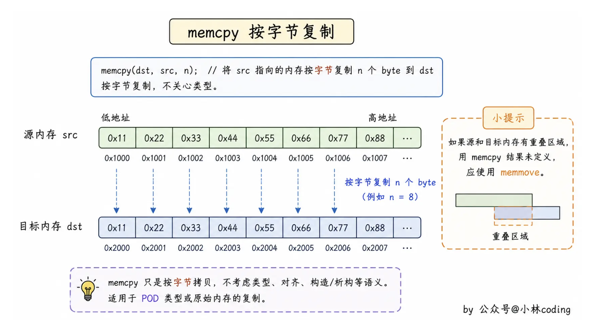
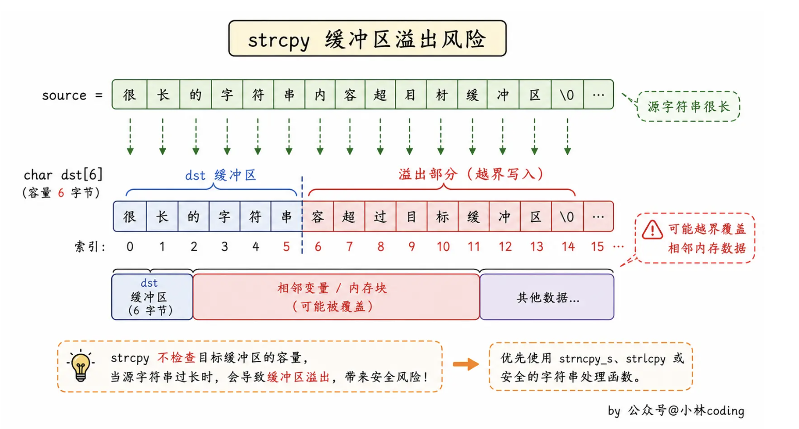

# 📘 3.5 数组 (Arrays)

> 基于《C++ Primer》第五版。详细整理数组的定义、初始化、访问方式、与指针的关系、C 风格字符串，以及与旧代码交互的方式。包含书中全部代码示例与对应解释，并保留警告和提示。

---

## 🧠 本章核心概念

* ✯ **数组的本质**

  * 固定大小、同类型的元素集合
  * 按下标访问，支持随机访问
  * 大小在编译期确定，不能增删
  * 相比 `vector` 少了灵活性，但有时性能更好

* ✯ **定义与初始化**

  * 维度是类型的一部分
  * 必须是编译期常量表达式
  * 默认初始化规则
  * 列表初始化（可省略维度）
  * 字符数组初始化特殊性

* ✯ **限制**

  * 内置数组不能整体拷贝或赋值
  * 某些编译器有非标准扩展

* ✯ **复杂声明**

  * 元素可为指针
  * 指针指向数组
  * 引用数组

* ✯ **访问元素**

  * 下标运算符
  * 范围 `for` 循环
  * 推荐 `size_t` 作为下标类型
  * 越界访问风险

* ✯ **指针与数组**

  * 数组名大多数情况下会转为首元素指针
  * `begin` / `end` 获取首尾
  * 指针算术与比较规则
  * 下标与指针等价关系

* ✯ **C 风格字符串**

  * 以 `'\0'` 结尾的 `char` 数组
  * C 标准库 `<cstring>` 函数
  * 常见错误与安全风险

* ✯ **与旧代码交互**

  * `string` ↔ C 风格字符串
  * 数组初始化 `vector`
  * 推荐用 `vector` 和 `string` 替代

---

## ✅ 数组的基本概念

### 📝 定义

数组是固定大小的、包含同类型元素的集合，通过下标（位置）访问元素。
和 `vector` 类似，数组元素没有名字，只能通过位置访问。

与 `vector` 的不同之处：

* 数组大小固定，不能动态添加或删除元素
* 不能改变大小
* 有时运行时性能更好，但灵活性差

💡 **建议**：

> 如果不能确定需要多少元素，优先用 `vector`。

---

## ✅ 3.5.1 定义和初始化内置数组
- 数组也是复合类型 `a[d]`
- 维度必须在编译态就知道，这就意味着维度一定是**常量表达式**

### 📝 维度必须是编译期常量表达式

```cpp
unsigned cnt = 42;          // 不是常量表达式
constexpr unsigned sz = 42; // 常量表达式

int arr[10];                // 10 个 int
int *parr[sz];               // 42 个指向 int 的指针
string bad[cnt];             // ❌ 错：cnt 不是常量表达式
string strs[get_size()];     // OK 如果 get_size() 是 constexpr，否则错误
```

**解释**：

* 数组的维度是类型的一部分，必须在编译期已知。
* 普通变量不能用作维度，`constexpr` 或常量表达式才行。

---

### 📝 默认初始化

- 💡 定义数组时必须显式指定类型，不能使用 `auto` 通过**初始值列表**推导类型。
- 💡 与 vector 一样，数组保存的是对象，而不是引用，因此 不能定义引用的数组。
- 💡 默认初始化规则与内置类型相同：

  - **在函数体外**定义的数组：元素自动初始化为零值。
  - **在函数体内**定义的内置类型数组：元素值未定义（危险）。

> ⚠️ Warning：函数内未初始化的内置类型数组不可直接使用。

---

### 📝 显式初始化

```cpp
const unsigned sz = 3;
int ia1[sz] = {0, 1, 2};  // 三个元素：0, 1, 2
int a2[]     = {0, 1, 2}; // 维度=3，由初始器个数推断
int a3[5]    = {0, 1, 2}; // 相当于 {0, 1, 2, 0, 0}
string a4[3] = {"hi", "bye"}; // 第三个元素值初始化为空串
int a5[2]    = {0, 1, 2}; // ❌ 错：初始器过多
```

规则：
* 指定维度时，初始器个数不得超过维度。
* 个数不足时，多余元素值初始化（内置类型为 0，类类型调用默认构造）。
* 使用列表初始化时，也可以不用指定维度，编译器会通过列表初始化器个数推断数组大小

---

### 📝 字符数组的特殊初始化

```cpp
char a1[] = {'C', '+', '+'};         // 维度=3，无 '\0'
char a2[] = {'C', '+', '+', '\0'};   // 维度=4，手动加终止符
char a3[] = "C++";                   // 维度=4，自动添加 '\0'
const char a4[6] = "Daniel";         // ❌ 错：需要至少 7 个元素
```

解释：

* **字符串字面值**结尾会自动加 `'\0'`
* 如果数组维度不足以容纳末尾的空字符，编译报错
* 因此每次计算字符串字面值的长度时，要注意null字符

---

### 📝 数组不能拷贝或赋值

```cpp
int a[]  = {0, 1, 2};
int a2[] = a;   // ❌ 错：不能用数组初始化数组
a2 = a;         // ❌ 错：不能整体赋值
```

> ⚠️ Warning：某些编译器允许数组赋值作为**扩展**，但这样程序移植不强， 不是所有编译器支持，**应避免**。

---

### 📝 复杂数组声明

```cpp
int *ptrs[10];       // ptrs 是 10 个指向 int 的指针
int (*Parray)[10];   // Parray 是指向含 10 个 int 的数组的指针
int (&arrRef)[10] = arr; // arrRef 是含 10 个 int 的数组的引用
int *(&arry)[10] = ptrs; // arry 是对含 10 个指向 int 的指针的数组的引用
```

💡 阅读方法：

1. 从变量名开始，从**右往左读，有括号就是从里往外读**
2. type modifier的数量不限


💡 举例:

1. `ptr` 的 `[10]` 定义了一个大小为10的数组，`*` 表示元素是pointer to int 
2. `Parray` 括号里的 `*` 表示 `Parray` 是pointer，外面的右边 `[10]` 表示大小为10，左边 `int` 表示数组元素类型为 `int`

---

## ✅ 3.5.2 访问数组元素
- 我们可以通过下标运算，和range-for访问元素
- 当我们使用下标运算，我们通常需要定义类型为 `size_t` 的变量
总结：
- **`size_t`** 是**与机器相关的无符号整数类型**，保证足够大以表示**内存中任意对象的大小**。
- 定义在 **`<cstddef>`** 头文件中（C++ 版本的 `stddef.h`）。
- 主要用于表示**数组下标**、**容器大小**、**对象的字节大小**等。
 

### 📝 下标运算符

* 数组支持下标访问，下标范围是 `[0, N-1]`。
* **不会检查越界**，越界访问是未定义行为，可能导致缓冲区溢出。

```cpp
unsigned scores[11] = {}; // 初始化全部为 0
unsigned grade;
while (cin >> grade) {
    if (grade <= 100)
        ++scores[grade/10]; // 根据成绩分到对应区间
}
```

解释：

1. `scores` 有 11 个元素，分别统计 \[0,9], \[10,19], …, \[100] 的个数。
2. 初始化 `{}` 会将所有元素置为 0。
3. 条件 `grade <= 100` 保证不越界。
4. 和 `string` `vector` 相同，我们需要特别注意 `array` 越界问题导致的 **buffer overflow**

---

### 📝 范围 `for` 循环

可以用范围 `for` 来访问数组元素：

```cpp
for (auto i : scores)
    cout << i << " ";
cout << endl;
```

解释：

* `auto i` 会推导为 `unsigned`。
* 遍历输出所有桶的计数。
* 范围 `for` 是访问数组最安全的方式，不易越界。

---

## ✅ 3.5.3 指针与数组

### 📝 数组名转指针

* 在大多数表达式中，数组名会**自动转换**为指向首元素的指针。

```cpp
string nums[] = {"one", "two", "three"};
string *p = nums;       // 等价于 &nums[0]
```

解释：

* `p` 指向 `nums` 的第一个元素 `"one"`。
* 这种自动转换称为 **衰变 (decay)**。

---

### 📝 `auto` 与 `decltype` 的区别

```cpp
int ia[] = {0, 1, 2, 3, 4};
auto ia2(ia);           // ia2 是 int* 类型，指向 ia[0]
decltype(ia) ia3 = {0, 1, 2, 3, 4}; // ia3 是含 5 个 int 的数组
```

解释：

* 用 `auto` 推导时，数组会衰变为指针类型。
* 用 `decltype` 会保留数组类型（包括维度）。

---

### 📝 指针也是迭代器


- 指向**数组元素**的指针，支持与 `vector`/`string` 迭代器**相同的基础操作**：
  - 解引用 `*p`
  - 递增 `++p`
  - 比较（仅限同一数组内）
  - 指针算术
- **首元素指针**：`arr` 或 `&arr[0]`。数组名在大多数表达式中会**衰变**为指向首元素的指针。
- **尾后指针**：`&arr[N]`（取“最后一个元素之后那个不存在元素”的地址）。它**不指向有效元素**，只能用来作比较或作为循环终止哨兵；**不能解引用或递增**。
- 这与容器的 `end()` 完全同理：**尾后位置仅作边界标记**。


```cpp
int arr[] = {0,1,2,3,4,5,6,7,8,9};

int *p = arr;   // p 指向首元素 arr[0]
++p;            // p 现在指向 arr[1]

int *e = &arr[10]; // 尾后指针：指向“最后一个元素之后”的位置
// 注意：不能对 e 做 *e 或 ++e 等操作

for (int *b = arr; b != e; ++b)
    std::cout << *b << std::endl; // 依次打印所有元素
```

**为什么 `&arr[10]` 合法？**
数组最后一个合法下标是 `9`，但标准允许**取一个“越后一位”的地址**来表示**尾后**

**安全提示**

* 只在**同一数组**内做指针比较/相减；跨不同对象的指针比较是未定义行为。
* 尾后指针（如 `&arr[N]`）**只能作为边界标记**，不要解引用或递增它。

---

### 📝 获取首尾指针 (C++11)
- 直接计算首尾指针仍然有极大报错倾向
- `<iterator>` 头文件中有 `begin()` 和 `end()` 两个函数，可以获取数组的首指针和尾后指针以一种安全方式

```cpp
int arr[] = {0, 1, 2, 3, 4};
int *beg = begin(arr); // &arr[0]
int *last = end(arr);  // &arr[5]（尾后位置）
```

---

### 📝 指针遍历数组

```cpp
int arr[] = {0, 1, 2, 3, 4, -1};
int *pbeg = begin(arr), *pend = end(arr);
while (pbeg != pend && *pbeg >= 0)
    ++pbeg; // 找到第一个负数或到尾
```

解释：

1. `pbeg != pend` 保证指针还在数组范围内。
2. `*pbeg >= 0` 保证当前元素非负。
3. `++pbeg` 将指针向后移动。

---

## ✅ 指针算术与比较

### 📝 基本运算

```cpp
constexpr size_t sz = 5;
int arr[sz] = {1, 2, 3, 4, 5};
int *ip = arr;       // 指向 arr[0]
int *ip2 = ip + 4;   // 指向 arr[4]
```

解释：

* `p + n` → 指向 `p` 后的第 n 个元素。
* 结果必须指向同一数组或尾后位置。

---

### 📝 生成尾后指针

```cpp
int *p = arr + sz;   // 指向尾后（不可解引用）
```

解释:

  - 数组名会隐式转换为指向首元素的指针，加上 `sz` 后得到的是指向数组尾后元素的指针


> ⚠️ Warning：超出尾后位置的指针是未定义的。

---

### 📝 指针差

```cpp
auto n = end(arr) - begin(arr); // n == 5
```

解释：

* 结果类型是 `ptrdiff_t`（有符号整数类型）
* 此类型定义在 `<cstddef>`
* 表示两个指针之间的距离。

---

### 📝 指针比较

```cpp
int *b = arr, *e = arr + sz;
while (b < e) {
    cout << *b << " ";
    ++b;
}
```

解释：

* 只有指向同一数组的元素（或尾后）才能比较大小。
* 比较不相关对象的指针是未定义的。

---
### 📝 空指针的运算

* 空指针不能被用来做真实的位移运算（+1、-1），因为它本身不指向任何对象。

* 只能做“无效果的运算”（加减 0），或者在比较时使用（比如 nullptr - nullptr == 0）。

---

### 📝 解引用与加法优先级

```cpp
int ia[] = {0, 2, 4, 6, 8};
int last = *(ia + 4); // ia[4] == 8
last = *ia + 4;       // (ia[0]) + 4 == 4
```

解释：

* 注意括号：`*(ia + 4)` 与 `*ia + 4` 含义不同。

---

### 📝 下标与指针等价
- 当我们使用数组名时，编译器会将其转换为指向该数组第一个元素的指针，例如在数组下标运算中就是这样处理的

```cpp
int ia[] = {0, 2, 4, 6, 8};
int i = ia[2];       // ia 转为首元素指针，再加 2
int *p = ia;
i = *(p + 2);        // 等价于 ia[2]

int *q = &ia[2];
int j = q[1];        // *(q + 1) → ia[3]
int k = q[-2];       // *(q - 2) → ia[0]
```
- 最后这一个例子很好的诠释了库类型如 `vector`，`string` 与 内置类型 `array` 在下标使用的区别:

  - 库类型：强制下标必须是**无符号值**，不能使用负数索引
  - 内置数组：允许下标是负值，它**不是无符号值**
  - 负数下标本质上还是指针算术运算，你可以"往回走"，但**不能**走出原数组的边界，否则就是未定义行为


---

## ✅ 3.5.4 C 风格字符串

> ⚠️ Warning：C 风格字符串容易出错，建议用 `string` 替代

### 📝 定义与终止符

* C 风格字符串是以 `'\0'` 结尾的字符数组。
* 字符串字面值本身是 `const char` 数组，并以 `'\0'` 结束

---

### 📝 `<cstring>` 函数

```cpp
strlen(p);   // 返回长度（不含 '\0'）
strcmp(p1, p2); // 按字典序比较
strcat(p1, p2); // 拼接p2到p1，返回p1（p1 必须有足够空间）
strcpy(p1, p2); // 复制p2进p1，返回p1（p1 必须有足够空间）
memcpy(p1, p2, n); // 复制p2起位置开始的n个字节的数据放入到p1开始的位置
```
**`memcpy` 函数的底层原理**
- **底层原理**：
  - 直接操作内存块的二进制数据
  - 它会从源地址开始，逐个字节(或按更高效的块)复制数据到目标地址，直到复制完指定的字节数
- **底层实现通常会做优化**：
  - 比如对对齐的内存块用更大的单位(如 4字节、8 字节)批量复制，比单字节循环更快;
  - 对未对齐的部分先用单字节处理到对齐位置，再用块复制
  - 整个过程不关心数据类型，纯粹按字节搬运，所以复制后目标内存和源内存的二进制内容完全一致，但不会处理像字符串结束符这类特殊情况


**`strcpy` 函数有什么缺陷**



⚠️ **注意事项**

- 这些函数 不会检查参数合法性。

- 传入的指针必须指向 以空字符 `'\0'` 结尾的数组（即 C 风格字符串）。

- 如果 `p1` 的空间不足以容纳拼接或复制结果，会导致 未定义行为（常见是 `strlen` 依赖字符串正确以 `'\0'` 结尾，否则会越界访问内存直到随机遇到 `'\0'`）。

---

### 📝 常见错误：未终止

```cpp
char ca[] = {'C', '+', '+'}; // 没有 '\0'
cout << strlen(ca) << endl;  // ❌ 未定义：strlen 会越界读取
```

---

### 📝 比较 C 字符串与 `string`

```cpp
string s1 = "A string example";
string s2 = "A different string";
if (s1 < s2) { /* 按内容比较 */ }

const char ca1[] = "A string example";
const char ca2[] = "A different string";
if (strcmp(ca1, ca2) < 0) { /* 按内容比较 */ }
```


* 库类型 `string`：可以直接用关系运算符 
* C 风格字符串：

  * 直接使用关系运算符的话，字符串退化为数组首指针， 直接比较**地址**， 结果未定义
  * 应该使用`strcmp`函数，返回 0 表示相等，正数表示第一个大于第二个，负数表示第一个小于第二个。


---


### 📝 C 风格字符串拼接与复制

* **`std::string`**：可以直接用 `+` 运算符拼接，简单且安全。

  ```cpp
  string largeStr = s1 + " " + s2;
  ```

* **C 风格字符串（`char[]`）**：

  * 表达式 `ca1 + ca2` 是非法的（相当于两个指针相加）。
  * 必须使用 **`strcpy`**（复制）和 **`strcat`**（拼接）。
  * 目标数组必须 **足够大**，能容纳结果字符串和末尾的 `'\0'`。

* **风险**：

  * 容易低估目标数组的大小，导致 **缓冲区溢出**。
  * 程序需要开发者手动计算大小，极易出错，是常见的安全漏洞来源。
> ⚠️ std::string 虽然底层更复杂，但由于自动管理内存、避免错误、带有优化机制，它在实际开发中通常比 C 风格字符串更安全、更省心，而且整体运行效率并不会比手写 C 风格代码差
---


## ✅ 3.5.5 与旧代码交互

很多 C++ 程序需要和 **C 语言程序** 或者更早的 C++ 代码交互，这些旧代码通常不使用 `std::string` 和 `std::vector`，而是依赖 **数组** 和 **C 风格字符串**。

---

### 📝 混合使用 `std::string` 和 C 风格字符串

* 可以使用 **字符串字面值**（null 结尾的字符数组）初始化或赋值给 `std::string`：

  ```cpp
  std::string s("Hello World");  // s = "Hello World"
  ```

* 可以将 **C 风格字符串** 与 `std::string` 一起使用：

  * 作为 `+` 运算符的其中一个运算符或 `+=` 的**右运算符**
  * 但不能同时两个操作数都是 C 风格字符串

---

### 📝 反向功能限制

* 不能直接用 `std::string` 初始化 `char*`：

  ```cpp
  char *str = s;        // ❌ 错误
  const char *str = s.c_str(); // ✅ 正确
  ```
* `s.c_str()` 返回一个 **const char\*** 指针，指向以 `'\0'` 结尾的数组，内容与 `s` 相同。

⚠️ 注意：

* `c_str()` 返回的指针只在 `s` 未被修改前有效；一旦 `s` 发生修改，该指针可能失效。
* 如果需要长期使用，必须将内容复制到自己管理的数组中。

---

### 📝 使用数组初始化 `vector`

* C++ 不允许用一个数组直接初始化另一个数组，也不能用 `vector` 初始化数组。
* 但可以用数组来初始化 `vector`，通过传入一对指针（或迭代器）指定范围：

```cpp
int int_arr[] = {0, 1, 2, 3, 4, 5};
std::vector<int> ivec(std::begin(int_arr), std::end(int_arr));
```

结果：`ivec` 有六个元素，分别是 `int_arr` 的拷贝。

* 可以用子范围来初始化：

```cpp
std::vector<int> subVec(int_arr + 1, int_arr + 4); 
// 拷贝 int_arr[1], int_arr[2], int_arr[3]
```

---

**⚠️ 警告 & 建议**

* **指针和数组容易出错**：

  * 用于底层操作，容易产生越界、悬空指针、语法复杂等问题。

* **现代 C++ 推荐**：

  * 用 `std::vector` 和迭代器代替内建数组和指针
  * 用 `std::string` 代替基于数组的 C 风格字符串

---


## 🍃 小结

### 📚 核心知识体系

1. **类型与大小**

   * 数组维度是**类型的一部分**，且必须是**编译期常量表达式**。
   * 大小固定，**不能增删**；数组**不能整体拷贝或赋值**。
2. **初始化规则**

   * 列表初始化可省略维度；不足元素**值初始化**。
   * **字符数组**用字符串字面量初始化会自动附加 `'\0'`，维度必须容纳它。
3. **访问与遍历**

   * 下标范围 `[0, N)`，**不做越界检查**；推荐范围 `for`。
   * `<iterator>` 的 `begin(arr)` / `end(arr)` 提供“首/尾后”指针。
4. **指针与衰变**

   * 大多数表达式中，数组名**衰变为指向首元素的指针**。
   * `auto` 遇数组→推导为**指针**；`decltype(ia)` 保留**数组类型与维度**。
5. **指针算术与比较**

   * `p+n`、`p2-p1`、`p<q` 仅对\*\*同一数组（或尾后）\*\*有意义；否则未定义。
   * `p[n] ≡ *(p+n)`；内置数组下标索引可为负，但指向位置必须仍在本数组（或尾后）。
6. **C 风格字符串**

   * 以 `'\0'` 结尾的 `char` 数组；`<cstring>` 函数**不检查边界**。
   * 直接比较指针无意义；内容比较用 `strcmp`。优先用 `string`。
7. **老代码交互**
  * `std::string` 与 C 风格字符串可以互相转换：
    * **C → string**：直接赋值或构造
    * **string → C**：使用 `.c_str()`
* 使用数组可以初始化 `vector`，通过 `begin(arr)` 和 `end(arr)`。
* **最佳实践**：尽量使用库类型（`string`, `vector`）来替代数组和指针，代码更安全、简洁、可维护。

---

### ⚡ 关键概念精要（记忆版）

* **“维度即类型”**：`int[10]` 与 `int[5]` 是**不同类型**。
* **三条红线**：数组**不能赋值**、**不能拷贝**、维度**必须常量表达式**。
* **auto/decltype**：`auto arr2(arr)` ⇒ `T*`；`decltype(arr)` ⇒ 原数组类型。
* **安全三件套**：`begin(arr)`、`end(arr)`、范围 `for`。
* **C 字符串三雷区**：未终止、缓冲区不足、把指针比较当内容比较。

---

### 🛡️ 易错/未定义行为清单

* 对**不同对象**指针做大小比较或相减。
* 访问**尾后**或**越界**位置；对尾后指针做解引用/递增。
* 字符数组维度**未包含 `'\0'`**；对**未终止**的数组用 `strlen/strcat/strcpy`。
* 将 `string` **直接**转为 `char*`（应使用 `c_str()` 且注意生命周期）。
* 使用 `auto` 误以为保留数组类型，导致后续语义跑偏。
* 尽量使用库类型（`string`, `vector`）来替代数组和指针，代码更安全、简洁、可维护。

---

### ✅ 最佳实践指南（写代码就照做）

* **不确定大小？用 `vector`**；文本处理？**用 `string`**。
* 遍历时优先：范围 `for` / `begin`+`end`；避免手写哨兵与魔法数。
* 只与**同一数组**内的指针做算术/比较；生成尾后指针用 `arr + N` 或 `end(arr)`。
* 字符数组 ← 字面量：**留足 `'\0'` 空间**；内容比较用 `strcmp`，连接/拷贝**先算空间**。
* 需要数组**类型信息**（含维度）时用 `decltype`；需要**值遍历**时小心 `auto` 的**指针衰变**。

---

### 🔄 对比速览

| 维度    | 内置数组             | `vector` / `string` |
| ----- | ---------------- | ------------------- |
| 大小    | 编译期固定            | 运行期可变               |
| 拷贝/赋值 | 不支持              | 支持                  |
| 越界检查  | 无（UB）            | `at()` 有边界检查        |
| 算法生态  | 指针/`begin`/`end` | 迭代器、完整算法库           |
| 文本处理  | C 字符串（危险）        | `string`（安全易用）      |

---


### 📝 `<cstring>` 常用函数速览表

| 函数                      | 功能                            | 返回值                                        | 注意事项 ⚠️                                 |
| ----------------------- | ----------------------------- | ------------------------------------------ | --------------------------------------- |
| `strlen(p)`             | 返回字符串 `p` 的长度（不含 `'\0'`）      | `size_t`                                   | `p` 必须是以 `'\0'` 结尾的合法字符串，否则会越界访问        |
| `strcmp(p1, p2)`        | 按字典序比较两个字符串                   | `0`：相等<br>`<0`：`p1 < p2`<br>`>0`：`p1 > p2` | 参数必须是以 `'\0'` 结尾的字符串；直接用 `==` 比较会变成地址比较 |
| `strcpy(dest, src)`     | 将 `src` 复制到 `dest`（包含 `'\0'`） | 返回 `dest`                                  | `dest` 必须有足够空间，否则缓冲区溢出                  |
| `strcat(dest, src)`     | 将 `src` 拼接到 `dest` 的末尾        | 返回 `dest`                                  | `dest` 必须足够大，容纳拼接结果和 `'\0'`             |
| `strncpy(dest, src, n)` | 复制最多 `n` 个字符                  | 返回 `dest`                                  | 如果 `src` 长度 ≥ `n`，结果可能没有 `'\0'`，需要手动补上  |

---

💡 **记忆技巧**：

* **len**（`strlen`） → 读长度
* **cmp**（`strcmp`） → 比大小
* **cpy**（`strcpy`） → 复制
* **cat**（`strcat`） → 拼接
* **ncpy**（`strncpy`） → 带长度限制的复制（但要自己加 `'\0'`！）

---


### 🎯 口令/口诀

* “**常量维度，数组不拷；名字一用，多半成指。**”
* “**同阵比较，越界免谈；字符串事，先看 `\0`。**”
* “**不定用容器，文本交 `string`。**”


