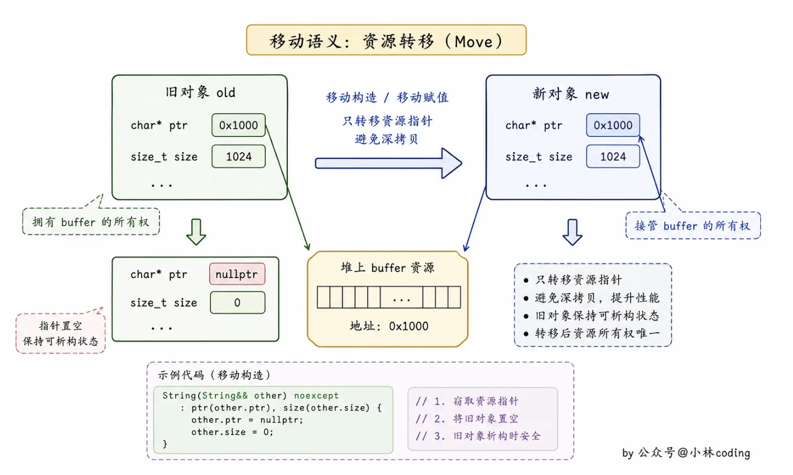
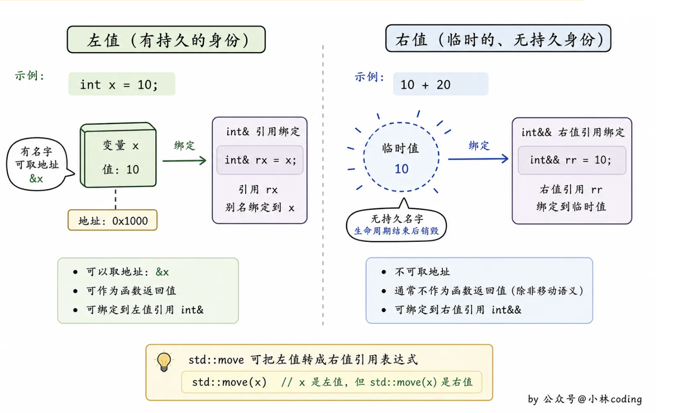

# 📘 13.6 移动对象 (Moving Objects)

> 来源说明：[C++ Primer 5th] 章节 13.6 | 本节涵盖：移动语义的背景、右值引用、移动构造函数与移动赋值运算符、合成移动操作、移动迭代器以及引用限定符成员函数。

---

## 🧠 核心概念总览（严格按原文顺序）

* [*知识点1: 移动而非拷贝的动机*](#id1)
* [*知识点2: 右值引用*](#id2)
* [*知识点3: 左值持久；右值短暂*](#id3)
* [*知识点4: 变量是左值*](#id4)
* [*知识点5: 库函数 move*](#id5)
* [*知识点6: 移动构造函数与移动赋值运算符*](#id6)
* [*知识点7: StrVec 移动构造函数*](#id7)
* [*知识点8: 移动操作、库容器与异常（C++11）*](#id8)
* [*知识点9: 移动赋值运算符*](#id9)
* [*知识点10: 移后源对象必须可析构*](#id10)
* [*知识点11: 合成的移动操作*](#id11)
* [*知识点12: 若无移动构造函数，右值也被拷贝*](#id12)
* [*知识点13: 拷贝并交换赋值运算符与移动*](#id13)
* [*知识点14: Message 类的移动操作*](#id14)
* [*知识点15: 移动迭代器*](#id15)
* [*知识点16: 提供拷贝和移动版本的成员函数*](#id16)
* [*知识点17: 右值和左值引用成员函数(C++11)*](#id17)
* [*知识点18: 重载与引用限定符*](#id18)

---
<a id="id1"></a>
## ✅ 知识点1: 移动而非拷贝的动机

**理论**
* **核心主旨总结**：新标准引入了<B>移动对象(move object)</b>的能力，而非总是拷贝。两种主要场景下移动极具价值：
  1. **性能提升**：某些情况下对象被拷贝后立即销毁（如 `StrVec` 重新分配），移动避免不必要的资源分配与释放。
  2. **不可拷贝但可移动的类型**：如 **IO 类**和 **`unique_ptr`**，它们拥有不可共享的资源（指针或 IO 缓冲），因此不能被拷贝，但可以移动。
  
* 在旧标准中无法直接移动，即使不必要也必须拷贝；大对象或需要内存分配的对象（如 `string`）拷贝开销昂贵。新标准允许将**仅可移动(move-only)** 的类型存入容器。


⚠️ **警告注意**：并非所有类型都可移动，某些类（如 IO、`unique_ptr`）可移动但不可拷贝，`string`和`shared_ptr`支持移动和拷贝


---
<a id="id2"></a>
## ✅ 知识点2: 右值引用 

**理论**
* **核心主旨总结**：
    * 新标准引入**右值引用(rvalue reference)**，通过 `&&` 获得，必须绑定到**右值(rvalue)**。
    * 右值引用的关键性质：**只能绑定到即将被销毁的对象**，因此可以自由地从该对象“移动”资源。
* **左值(lvalue)与右值(rvalue)**：左值表达式表示对象的**身份(identity)**，右值表达式表示对象的**值(value)**
* **绑定规则对比**：
  - **左值引用(lvalue reference)**（常规引用）不能绑定到要求转换的表达式、字面常量或返回右值的表达式。
  - **右值引用**可以绑定到这类表达式，但不能直接绑定到左值。
* **返回左值的表达式**：返回左值引用的函数、赋值、下标、解引用、前置递增/递减。可绑定左值引用。
* **返回右值的表达式**：返回非引用类型的函数、算术、关系、位运算、后置递增/递减。**但是可绑定 `const` 左值引用或右值引用**。

**教材示例代码**
```cpp
int i = 42;
int &r = i;                // ok: r refers to i
int &&rr = i;             // error: 无法右值引用绑定左值
int &r2 = i * 42;        // error: i * 42 is an rvalue
const int &r3 = i * 42;  // ok: we can bind a reference to const to an rvalue
int &&rr2 = i * 42;      // ok: bind rr2 to the result of the multiplication
double& dr = i;        // ❌ 错误！需要把 int 转换成 double
```

⚠️ **警告注意**：左值引用（`T&`）只能绑定到左值，右值引用（`T&&`）只能绑定到右值， 但是`const`左值可以绑定右值。

---

<a id="id3"></a>
## ✅ 知识点3: 左值持久；右值短暂 

**理论**
* 左值与右值的本质区别：
    - **左值具有持久状态**，左值通常表示具有明确身份、可以定位的对象
    - **右值是字面常量或求值过程中创建的临时对象**，即将被销毁

* 右值引用绑定到临时对象意味着：
  - 被引用的对象**即将被销毁**。
  - 该对象**没有其他用户**。
* 因此，使用右值引用的代码可以自由地 **接管(take over)** 该对象的资源


**注意点**
* 💡 **理解技巧**：右值引用是“窃取”资源的通行证。


---

<a id="id4"></a>
## ✅ 知识点4: 变量是左值 

**理论**
* **核心主旨总结**：
    * 变量是表达式，且属于**左值**。
    * 即使变量被定义为右值引用类型，该变量本身的表达式仍然是左值。
    * 因此，**不能将右值引用直接绑定到一个变量**（即使是右值引用变量）。

**教材示例代码**
```cpp
int &&rr1 = 42;  // ok: literals are rvalues
int &&rr2 = rr1; // error: the expression rr1 is an lvalue!
```

 ⚠️ **警告注意**：变量是左值，不能将右值引用绑定到变量。
💡 **理解技巧**：变量有名字，可以多次使用，因此是左值。

---

<a id="id5"></a>
## ✅ 知识点5: 库函数 `move` 

**理论**
* **核心主旨总结**：
    * 虽然不能直接将右值引用绑定到左值，但可以**显式地将左值转换为对应的右值引用类型**。
    * 标准库函数 `std::move`（定义在 `<utility>` 头文件）完成此转换，返回给定对象的右值引用。
* **调用 `move` 的承诺**：
    * 表示告诉编译器，我们将源对象（lvalue）当成一个rvalue了。
    * 除了对移后源对象进行**赋值**或**销毁**外，不再使用它。
    * **不能对移后源对象的值做任何假设**。
* 与多数标准库名字不同，**通常不为 `move` 提供 `using` 声明**，而是直接使用 `std::move`，以避免潜在的名字冲突（原因见 §18.2.3）。

**教材示例代码**
```cpp
int &&rr3 = std::move(rr1); // ok
```

⚠️ **警告注意**：使用 `move` 时应写 `std::move`，而非 `move`。
💡 **理解技巧**：`move` 只是类型转换，并不真正移动任何东西，移动操作发生在构造函数或赋值运算符中。

---

<a id="id6"></a>
## ✅ 知识点6: 移动构造函数与移动赋值运算符 

**理论**
* **核心主旨总结**：
    * 自定义类可以通过定义**移动构造函数(move constructor)** 和**移动赋值运算符(move-assignment operator)** 来支持移动操作。
    * 它们类似于拷贝操作，但“窃取”资源而非拷贝。
* 移动构造函数的第一个参数是**本类类型的右值引用**，任何额外参数都必须有默认实参。
* **必须确保移后源对象处于可安全销毁的状态**，通常将其内部指针置为 `nullptr`，使得析构函数无害。
* 这个原本的对象不再指向移动的资源，管理这个资源的责任交给了新创造的对象

---

<a id="id7"></a>
## ✅ 知识点7: `StrVec` 移动构造函数

**理论**
* **核心主旨总结**：
    * `StrVec` 移动构造函数**不分配新内存**，直接接管源对象的指针成员（`elements`, `first_free`, `cap`），然后将源对象的指针置为 `nullptr`，使其处于可析构状态。
    * 资源被移动后，当源对象退出自己的scope的时候，析构函数销毁这个空壳

 ⚠️ **警告注意**：如果不将源对象指针置空，源对象析构时会释放已被移动的内存，导致**双重释放**。

**教材示例代码**
```cpp
StrVec::StrVec(StrVec &&s) noexcept // move won't throw any exceptions
    : elements(s.elements), first_free(s.first_free), cap(s.cap)
{
    // leave s in a state in which it is safe to run the destructor
    s.elements = s.first_free = s.cap = nullptr;
}
```


---

<a id="id8"></a>
## ✅ 知识点8: 移动操作、库容器与异常（C++11） 

**理论**
* **核心主旨总结**：
    * 移动操作通常不分配资源，因此**不会抛出异常**。
    * 若移动操作可能抛出异常，标准库容器（如 `vector`）在重新分配时会**优先使用拷贝构造函数**以保证异常安全。
        * 因为标准库就有可能做多余的工作去处理异常
    * 所以我们一定要让标准库知道，我们写的这个构造函数时“安全”的。
* **使用 `noexcept` 告知库**：若移动构造函数标记为 `noexcept`，`vector` 将选择移动而非拷贝；否则为安全起见使用拷贝。
* 不过`noexcept`并没有解决任何问题，移动构造函数仍有出问题的可能。
* `noexcept` 必须同时在类内声明和类外定义中出现。
* `noexcept` 出现在参数列表后面。

💡 **理解技巧**：`noexcept` 是对库的“信任状”，允许库采用更高效的移动操作。
⚠️ **注意**：
* `noexcept` 主要影响的是标准库容器（如 `vector`）在重新分配内存时是否选择移动操作。
* 如果移动操作可能抛出异常，容器为了安全会改用拷贝。
    * 以避免移动部分元素后抛出异常导致原状态被破坏
* 即使移动操作未标记 `noexcept`，只要传递的是右值，编译器仍会依据重载决议调用移动操作。


**教材示例代码**
```cpp
class StrVec {
public:
    StrVec(StrVec&& s) noexcept; // move constructor
    // other members as before
};

StrVec::StrVec(StrVec &&s) noexcept : /* member initializers */
{ /* constructor body */ }
```

---

<a id="id9"></a>
## ✅ 知识点9: 移动赋值运算符 

**理论**
* **核心主旨总结**：
    * 移动赋值运算符执行与析构函数+移动构造函数相似的工作。
    * 必须**检查自赋值**，释放左操作数原有资源，接管右操作数资源，并将右操作数指针置为 `nullptr`。
* 自赋值检查是必要的，因为右操作数可能是 `std::move` 作用于左操作数的结果。

**注意点**
* ⚠️ **警告注意**：自赋值检查至关重要，否则可能释放了右操作数的资源，导致后续接管无效指针。
* 💡 **理解技巧**：移动赋值是“先销毁自己，再偷别人”。

**教材示例代码**
```cpp
StrVec &StrVec::operator=(StrVec &&rhs) noexcept
{
    // direct test for self-assignment
    if (this != &rhs) {
        free();
        elements = rhs.elements;   // take over resources from rhs
        first_free = rhs.first_free;
        cap = rhs.cap;
        // leave rhs in a destructible state
        rhs.elements = rhs.first_free = rhs.cap = nullptr;
    }
    return *this;
}
```


---

<a id="id10"></a>
## ✅ 知识点10: 移后源对象必须可析构 

**理论**
* **核心主旨总结**：
    * 移动操作不会销毁源对象，源对象稍后仍会被析构。
    * 因此必须确保移后源对象**处于可安全析构的状态**。
    * 此外，移后源对象应保持**有效(valid)**，即可以赋予新值或执行不依赖当前值的操作，但其**值未指定(unspecified)**。
* `StrVec` 移动操作将移后源对象置于与默认初始化相同的状态（指针为 `nullptr`），所有操作仍可正常执行。
    * 但是并不能确定会给我们什么结果。
* 其他类可能有更复杂的内部结构，行为可能不同。


**注意点**
* ⚠️ **警告注意**：移后源对象必须保持有效、可析构，但**程序绝不能依赖其值**。
* 💡 **理解技巧**：移后源对象像是一个“空壳”，可以安全地销毁或赋予新值，但不保证为空。

---

<a id="id11"></a>
## ✅ 知识点11: 合成的移动操作 
**理论**
* **核心主旨总结**：
    * 编译器合成移动构造/赋值运算符的条件比拷贝操作严格得多：
        1. 该类**没有定义任何自己的拷贝控制成员**（拷贝构造、拷贝赋值、析构函数）。
        2. 每个非静态数据成员都**可移动**（内置类型可移动，类类型有其移动操作就可移动）。
* 与拷贝操作不同，移动操作永远不会被隐式定义为删除的函数。
* **但是若显式请求 `= default` 但无法移动所有成员，则移动操作被定义为删除**。
* **删除规则**（与拷贝操作类似但有例外）：
  - 若类有成员定义了拷贝构造但未定义移动构造，或成员无法合成移动构造，则移动构造定义为删除（若显式请求）。
  - 若成员的移动构造/赋值是删除的或不可访问，则合成移动操作定义为删除。
  - 若析构函数是删除的或不可访问，移动构造定义为删除。
  - 若类有 `const` 或引用成员，移动赋值定义为删除。


**注意点**
* ⚠️ **警告注意**：若类定义了任何移动操作，则**合成的拷贝构造函数和拷贝赋值运算符会被定义为删除**。
    * 这意味着**定义了移动操作的类必须也定义自己的拷贝操作**。

* 💡 **理解技巧**：拷贝操作是“默认可用”的，移动操作是“默认不可用”的，需满足苛刻条件才会合成。

**教材示例代码**
```cpp
// the compiler will synthesize the move operations for X and hasX
struct X {
    int i;               // built-in types can be moved
    std::string s;       // string defines its own move operations
};
struct hasX {
    X mem;               // X has synthesized move operations
};
X x, x2 = std::move(x);          // uses the synthesized move constructor
hasX hx, hx2 = std::move(hx);    // uses the synthesized move constructor

// assume Y is a class that defines its own copy constructor but not a move constructor
struct hasY {
    hasY() = default;
    hasY(hasY&&) = default;
    Y mem;                       // hasY will have a deleted move constructor
};
hasY hy, hy2 = std::move(hy);    // error: move constructor is deleted
```
**代码解析**
* 编译器只能拷贝`Y`而不能移动`Y`对象
* 但是`hasY`显式请求编译器定义移动构造函数
* 因为你通过 `= default` 强制要求生成，它在发现无法移动成员后，只能无奈地将其明确定义为 `= delete`.


---
<a id="id12"></a>
## ✅ 知识点12: 若无移动构造函数，右值也被拷贝 

**理论**
* **核心主旨总结**：
    * 当类同时拥有移动构造函数和拷贝构造函数时，编译器使用普通的**函数匹配规则**来决定调用哪一个
    * 但是如果一个类有拷贝构造函数但没有移动构造函数，即使使用`std::move`，**函数匹配仍会选择拷贝构造函数**。
* 这种做法是安全的：拷贝构造函数不会改变源对象，且满足移动操作的基本要求。

**注意点**
* 💡 **理解技巧**：
    * “移动”回退为拷贝，就像用拷贝构造函数“假装”移动，这个对于拷贝赋值和移动赋值也是同样道理。

**教材示例代码**
```cpp
class Foo {
public:
    Foo() = default;
    Foo(const Foo&); // copy constructor
    // other members, but Foo does not define a move constructor
};

Foo x;
Foo y(x);                  // copy constructor; x is an lvalue
Foo z(std::move(x));       // copy constructor, because there is no move constructor
```
**代码解析**
* 因为移动构造函数不存在，而拷贝构造函数接受 `const Foo&`，右值引用`T&&`可以转换为 `const T&` 左值引用，所以拷贝构造函数是可行的。


---

<a id="id13"></a>
## ✅ 知识点13: 拷贝并交换赋值运算符与移动 
**理论**
* **核心主旨总结**：
    * 定义了移动构造函数的 `HasPtr` 类，其**拷贝并交换赋值运算符**（参数为非引用类型）**同时充当拷贝赋值和移动赋值**：
  - 参数 `rhs` 通过**拷贝初始化(copy initialization)** 获得：若实参是左值，调用拷贝构造函数；若实参是右值，调用移动构造函数。
  - 赋值运算符体内通过 `swap` 交换 `*this` 与 `rhs`，`rhs` 析构时释放原左操作数的资源。
* 这种设计避免重复编写两个赋值运算符。

* **使用`swap`的优势**：

    * **资源管理自动化**：参数按值传递天然区分左值/右值，函数体内只需处理交换，资源管理自动完成。
    * **无需额外定义**：此模式自动获得移动赋值，无需额外定义移动赋值运算符。

**教材示例代码**
```cpp
class HasPtr {
public:
    // added move constructor
    HasPtr(HasPtr &&p) noexcept : ps(p.ps), i(p.i) { p.ps = 0; }
    // assignment operator is both the move- and copy-assignment operator
    HasPtr& operator=(HasPtr rhs)
        { swap(*this, rhs); return *this; }
    // other members as in § 13.2.1 (p. 511)
};

// usage:
hp = hp2;                    // hp2 is lvalue → copy constructor copies hp2
hp = std::move(hp2);         // move constructor moves hp2
```


---

<a id="id14"></a>
## ✅ 知识点14: `Message` 类的移动操作 

**理论**
* **核心主旨总结**：
    * `Message` 类（与 `Folder` 协同）应定义移动操作，避免拷贝 `contents` 和 `folders` 的开销。
* **辅助函数 `move_Folders`**：
  - 使用 `std::move` 调用 `set` 的移动赋值，将 `m->folders` 移动到 `this->folders`。
  - 遍历 `folders`，对每个 `Folder`：**删除指向旧 `Message` 的指针**，**添加指向新 `Message` 的指针**。
  - 最后 `clear` 源对象的 `folders`，使其可安全析构。
* **移动构造函数**：使用 `std::move` 移动 `contents`，然后调用 `move_Folders`。
* **移动赋值运算符**：先检查自赋值，调用 `remove_from_Folders()` 解除与当前 `Folder` 的关联，移动 `contents`，再调用 `move_Folders`。
* **注意异常**：向 `set` 插入元素可能抛出 `bad_alloc`，因此**不标记为 `noexcept`**。

**注意点**
* ⚠️ **警告注意**：移动操作可能抛出异常（内存分配失败），因此不应标记 `noexcept`。
* 💡 **理解技巧**：`Message` 的移动不仅要转移数据，还要更新所有指向它的 `Folder`，这是“资源窃取 + 依赖更新”。

**教材示例代码**
```cpp
void Message::move_Folders(Message *m)  // m 是源对象（即将被掏空）
{
    // 1. 偷走 m 的 folders 集合（O(1)，不拷贝）
    folders = std::move(m->folders);
    
    // 2. 更新每个 Folder：删除旧 Message，添加新 Message
    for (auto f : folders) {
        f->remMsg(m);      // 从 Folder 中移除 m
        f->addMsg(this);   // 向 Folder 添加 this（新对象）
    }
    
    // 3. 清空 m 的 folders，确保 m 析构时不会重复操作
    m->folders.clear();
}

Message::Message(Message &&m) : contents(std::move(m.contents))
{
    move_Folders(&m); // moves folders and updates the Folder pointers
}

Message& Message::operator=(Message &&rhs)
{
    if (this != &rhs) {               // direct check for self-assignment
        remove_from_Folders();
        contents = std::move(rhs.contents); // move assignment
        move_Folders(&rhs);           // reset the Folders to point to this Message
    }
    return *this;
}
```
---

<a id="id15"></a>
## ✅ 知识点15: 移动迭代器 

**理论**
* **核心主旨总结**：
    * `uninitialized_copy`只能拷贝，没有 "`uninitialized_move`"这种函数。
    * 但是新标准库C++11定义了**移动迭代器(move iterator)** 适配器。
    * 这是一种迭代器适配器，其解引用运算符返回**右值引用**，从而在算法中**移动而非拷贝**元素。
    * 通过 `make_move_iterator` 将普通迭代器转换为移动迭代器。
        * 所有普通迭代器的操作如以前一般都支持。
        * 可以传递给 `uninitialized_copy` 等算法，使得 `construct` 调用移动构造函数。
* **谨慎使用**：标准库未保证所有算法与移动迭代器安全配合。移动后源对象被破坏，算法不应在移动后再次访问该元素或将其传递给用户定义函数。

**注意点**
* ⚠️ `std::move` 的使用建议：

    **风险警示**：`std::move` 会将对象置为"被移动"状态，此时对象处于不确定状态，继续使用它是危险操作。调用前必须**绝对确定**该对象不会再被其他代码使用。

    **适用场景**：仅在类内部实现代码（如移动构造函数、移动赋值运算符）中谨慎使用，可以获得显著性能提升。在普通用户代码中随意使用 `std::move`，更可能引入神秘且难以发现的 bug，而非真正提升性能。

    **最佳实践**：除非在类实现代码中，否则只有当你**确实需要移动**且**能完全保证安全**时，才使用 `std::move`。
    * 💡 **理解技巧**：移动迭代器是将“拷贝语义”算法转化为“移动语义”的便捷工具。

**教材示例代码**
```cpp
void StrVec::reallocate()
{
    // allocate space for twice as many elements as the current size
    auto newcapacity = size() ? 2 * size() : 1;
    auto first = alloc.allocate(newcapacity);
    // move the elements
    auto last = uninitialized_copy(make_move_iterator(begin()),
                                   make_move_iterator(end()),
                                   first);
    free(); // free the old space
    elements = first;   // update the pointers
    first_free = last;
    cap = elements + newcapacity;
}
```


---

<a id="id16"></a>
## ✅ 知识点16: 提供拷贝和移动版本的成员函数

**理论**
* **核心主旨总结**：
    * 除了构造/赋值，其他成员函数也可受益于拷贝/移动重载。
    * 通常模式是**一个版本接受 `const T&`，另一个接受 `T&&`**。例如标准库容器的 `push_back`。
* **不需要 `const X&&` 或 `X&` 版本**：移动版本用于窃取资源，参数应为非 `const` 右值；拷贝版本不应修改源对象。
* **`StrVec` 的 `push_back` 重载**：左值版本拷贝元素，右值版本移动元素（通过 `std::move` 调用 `string` 移动构造函数）。

**注意点**
* ⚠️ **注意**：总结：区分拷贝和移动的重载函数，通常一个接受 `const T&`（拷贝），一个接受 `T&&`（移动）。
* 💡 **理解技巧**：重载 `push_back` 使得容器可以高效地插入临时字符串，避免不必要的拷贝。


**教材示例代码**
```cpp
class StrVec {
public:
    void push_back(const std::string&); // copy the element
    void push_back(std::string&&);      // move the element
    // other members as before
};

// unchanged from the original version in § 13.5 (p. 527)
void StrVec::push_back(const string& s)
{
    chk_n_alloc();
    alloc.construct(first_free++, s);
}

void StrVec::push_back(string&& s)
{
    chk_n_alloc();
    alloc.construct(first_free++, std::move(s));
}

// usage:
StrVec vec;
string s = "some string or another";
vec.push_back(s);        // calls push_back(const string&)
vec.push_back("done");   // calls push_back(string&&)
```
**代码解析**
* 函数`construct`通过第二个参数判断调用哪一个构造函数
* 因为`std::move`返回的是`T&&`，所以传入到`construct`的参数就是`string&&`
* 因此`construct`函数内会用到`string`的移动构造函数来构造新的元素

---

<a id="id17"></a>
## ✅ 知识点17: 右值和左值引用成员函数（C++11） 

**理论**
* **核心主旨总结**：
    * 新标准前无法阻止对右值赋值等这种不合理操作
    * 现在可以在成员函数参数列表后添加**引用限定符(reference qualifier)**（`&` 或 `&&`），限定 `this` 指向的对象是左值还是右值（和之前`const`做法一样）。
* 例如，可**禁止对右值对象赋值**：将赋值运算符定义为 `&&` 限定，则只能用于可修改的右值，左值对象无法调用。
* **引用限定符必须同时出现在声明和定义中**，且可同时使用 `const` 限定符，此时 `const` 必须在前。
* 不带引用限定符的成员函数可以在左值或右值对象上调用。

**注意点**
* ⚠️ **警告注意**：引用限定符的位置：必须跟在 `const` 之后（如果有），且在参数列表之后。
* 💡 **理解技巧**：引用限定符控制成员函数的**调用者(this)** 是左值还是右值。

**教材示例代码**
```cpp
class Foo {
public:
    Foo &operator=(const Foo&) &; // may assign only to modifiable rvalues
    // other members of Foo

    Foo someMem() & const; // error: const qualifier must come first
    Foo anotherMem() const &; // ok: const qualifier comes first

};

Foo &Foo::operator=(const Foo &rhs) &
{
    // do whatever is needed to assign rhs to this object
    return *this;
}

// calling:
Foo &retFoo();  // returns a reference; a call to retFoo is an lvalue
Foo retVal();   // returns by value; a call to retVal is an rvalue
Foo i, j;
i = j;          // ok: i is an lvalue
retFoo() = j;   // ok: retFoo() returns an lvalue
retVal() = j;   // error: retVal() returns an rvalue
i = retVal();   // ok: we can pass an rvalue as the right-hand operand to assignment
```

---

<a id="id18"></a>
## ✅ 知识点18: 重载与引用限定符 

**理论**
* **核心主旨总结**：
    * 可以基于引用限定符重载成员函数，也可与 `const` 组合。例如 `Foo::sorted()` 提供两个版本：
  - `sorted() &&`：对可修改右值，可**原地排序(in-place sort)**。
  - `sorted() const &`：对 `const` 右值或左值，**拷贝后排序**。
* **重载决议**(overloaded reolution)：根据调用对象的左值/右值属性选择最匹配版本。
* **一致性要求**：
    * 若一组重载具有相同的名称和参数列表，则**要么全部提供引用限定符，要么全不提供**。
    * 不能一部分限定、一部分不限。

**注意点**
* ⚠️ **警告注意**：引用限定符不能部分使用——所有同名同参数列表的重载要么都有限定符，要么都没有。


**教材示例代码**
```cpp
class Foo {
public:
    Foo sorted() &&;
    Foo sorted() const; // error: must have reference qualifier
    // Comp is type alias for the function type (see § 6.7 (p. 249))
    // that can be used to compare int values
    using Comp = bool(const int&, const int&);
    Foo sorted(Comp*); // ok: different parameter list
    Foo sorted(Comp*) const; // ok: neither version is reference qualified
};
```

---

## 🔑 核心要点总结
1. **右值引用是移动语义的核心**：它只能绑定到即将销毁的临时对象，允许安全地“窃取”资源。`std::move` 将左值转换为右值引用，但使用后不应再依赖原对象的值。
2. **移动构造函数与移动赋值运算符**：它们应标记为 `noexcept`（若不抛异常），接管源对象资源并将源对象置为可析构状态。注意自赋值检查和异常安全。
3. **合成移动操作的条件极其严格**：仅当类未定义任何拷贝控制成员且所有数据成员可移动时，编译器才会合成移动操作。定义移动操作会抑制合成拷贝操作，因此需同时定义拷贝操作。
4. **移动迭代器**将普通迭代器转换为右值解引用，使 `uninitialized_copy` 等算法执行移动而非拷贝，但需谨慎使用。
5. **引用限定符**扩展了成员函数的重载能力，允许根据对象是左值还是右值选择不同行为，是实现“移动友好”接口的重要工具。

## 📌 考试速记版
* **右值引用特性**：`&&`，绑定右值，不能直接绑定左值（`std::move` 转换）。
* **移动操作三要素**：`noexcept`、资源转移、源对象置为可析构状态。
* **合成移动条件**：无自定义拷贝控制成员 + 所有成员可移动。
* **移动回退为拷贝**：有拷贝无移动 → `std::move` 仍调拷贝构造。
* **移动迭代器**：`make_move_iterator` + `uninitialized_copy` 实现批量移动构造。
* **引用限定符**：`&`（左值对象可调用）、`&&`（右值对象可调用），重载时须一致。
* **典型错误**：移动后仍使用源对象值、忘记标记 `noexcept` 导致 `vector` 使用低效拷贝、自赋值未检查。

**记忆口诀**：
> 右值引用绑临时，`move` 转换左值移。  
> 移动构造窃资源，源置空壳析构安。  
> `noexcept` 许高效，合成条件严且少。  
> 无移则拷保安全，迭代器移需谨慎。  
> 引用限定分左右，重载一致莫遗漏。