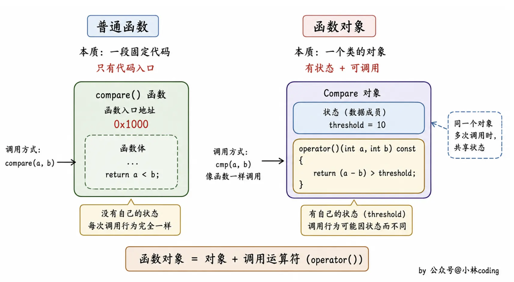

# 📘 14.8. Function-Call Operator (函数调用运算符)

> 来源说明：C++ Primer 5th 第14.8节 | 本节涵盖：函数调用运算符的重载、函数对象、lambda与函数对象的联系、标准库定义的函数对象、可调用对象与function类型

---

## 🧠 核心概念总览（严格按原文顺序）

* [*知识点1: 函数调用运算符的基本概念*](#id1)
* [*知识点2: absInt函数对象类示例*](#id2)
* [*知识点3: 函数调用运算符必须是成员函数*](#id3)
* [*知识点4: 带状态的函数对象类*](#id4)
* [*知识点5: PrintString类的定义与构造函数*](#id5)
* [*知识点6: PrintString对象的使用示例*](#id6)
* [*知识点7: 使用PrintString与for_each算法*](#id7)
* [*知识点8: lambda是函数对象*](#id8)
* [*知识点9: 带捕获的lambda生成的类*](#id9)
* [*知识点10: 标准库定义的函数对象*](#id10)
* [*知识点11: 使用库函数对象与算法*](#id11)
* [*知识点12: 可调用对象与function类型*](#id12)
* [*知识点13: 不同类型可具有相同调用签名*](#id13)
* [*知识点14: 标准库function类型*](#id14)
* [*知识点15: 重载函数与function*](#id15)
* [*知识点16: Note：function与bind的关系*](#id16)

---

<a id="id1"></a>
## ✅ 知识点1: 函数调用运算符的基本概念

**理论**

* 重载了**函数调用运算符**的类，其对象可以像函数一样使用。
* 由于这样的类可以存储状态，因此它们比普通函数更灵活。
* **核心主旨**：通过重载`operator()`，让类的对象拥有函数的行为，并且可以利用成员存储状态实现定制化操作


**函数对象 VS 普通函数**
- **定时方式**:
    - **普通函数**是用 标识符 `返回类型 函数名(参数)` 语法定义的，属于全局或某个命名空间下的独立代码块
    - 而函数对象是一个类或结构体，并重载了 `operator()`的实例
- **状态**:
    - 普通函数无状态
    - 而函数对象可以有内置的状态(成员变量)
- **调用方式**:
    - 普通函数被直接调用
    - 函数对象需要先创建实例，然后用实例调用
- **灵活性**:
    - 函数对象可以重载多个操作符或添加更多功能
    - 普通函数则只能定义一个函数


**注意点**
* 💡 **理解技巧**：函数对象是“行为像函数的对象”，但本质是类的实例。


---

<a id="id2"></a>
## ✅ 知识点2: `absInt`函数对象类示例

**理论**

* 定义了一个简单的函数对象类`absInt`，它的调用运算符返回参数的绝对值。
* 通过向`absInt`对象传递参数来“调用”它，实际执行的是`operator()`成员函数。

**注意点**
* 💡 **理解技巧**：`absObj(i)` 语法上像函数调用，但实际上是调用了对象的`operator()`成员。
* ⚠️ **警告注意**：即使`absObj`是对象而非函数，我们仍可以“调用”它。

**教材示例代码**

```cpp
struct absInt {
    int operator()(int val) const {
        return val < 0 ? -val : val;
    }
};

int i = -42;
absInt absObj;                  // 含有函数调用运算符的对象
int ui = absObj(i);              // 将 i 传递给 absObj.operator()
```


---

<a id="id3"></a>
## ✅ 知识点3: 函数调用运算符必须是成员函数

**理论**

* **函数调用运算符必须是成员函数**。
* 一个类可以定义多个版本的调用运算符，它们必须在参数数量或类型上有所区别。

**注意点**
* ⚠️ **重要限制**：`operator()`只能作为成员函数重载，不能是友元或普通函数。
* 🔄 **知识关联**：这与其他运算符（如赋值、下标）类似，某些运算符必须定义为成员。

---

<a id="id4"></a>
## ✅ 知识点4: 带状态的函数对象类

**理论**

* 函数对象类可以像任何其他类一样拥有除`operator()`以外的成员。
* 这些数据成员通常用于定制调用运算符中的操作行为。
* 通过构造函数初始化这些成员，使得函数对象可以携带状态。


**注意点**
* 💡 **理解技巧**：状态使得同一个函数对象类可以产生不同行为的实例（例如输出到不同流、使用不同分隔符）。

---

<a id="id5"></a>
## ✅ 知识点5: `PrintString`类的定义与构造函数

**理论**

* 定义一个`PrintString`类，其功能是打印一个字符串参数。
* 默认情况下，它向`cout`写入，并在每个字符串后打印一个空格。
* 允许用户提供不同的输出流和不同的分隔符。

**教材示例代码**

```cpp
class PrintString {
public:
    PrintString(ostream &o = cout, char c = ' ') : os(o), sep(c) {}
    void operator()(const string &s) const { os << s << sep; }
private:
    ostream &os;   // 写入的流
    char sep;      // 每个输出后打印的字符
};
```

**注意点**
* 💡 **理解技巧**：构造函数使用默认实参，使得可以灵活创建不同行为的对象。

---

<a id="id6"></a>
## ✅ 知识点6: `PrintString`对象的使用示例

**理论**

* 创建`PrintString`对象时，可以使用默认值或自定义输出流和分隔符。
* 然后可以像函数一样调用这些对象来打印字符串。

**教材示例代码**

```cpp
PrintString printer;      // 使用默认值，输出到cout，分隔符为空格
printer(s);                // 将s输出到cout，后跟一个空格

PrintString errors(cerr, '\n'); // 输出到cerr，分隔符为换行
errors(s);                 // 将s输出到cerr，后跟一个换行
```

**注意点**
* 💡 **理解技巧**：同一个类可以产生不同行为的函数对象，通过构造函数参数定制。

---

<a id="id7"></a>
## ✅ 知识点7: 使用`PrintString`与`for_each`算法

**理论**

* 函数对象最常用于泛型算法的实参。
* 可以将`PrintString`临时对象传递给`for_each`算法，打印容器中的每个元素。

**教材示例代码**

```cpp
for_each(vs.begin(), vs.end(), PrintString(cerr, '\n'));
```

* 这里，`for_each`的第三个参数是一个临时的`PrintString`对象，用`cerr`和换行符初始化。
* `for_each`将对`vs`中的每个元素调用这个函数对象，从而将每个元素输出到`cerr`后跟换行。

**注意点**
* 🔄 **知识关联**：这种用法与lambda表达式非常相似，因为lambda本质上就是函数对象。

---

<a id="id8"></a>
## ✅ 知识点8: lambda是函数对象

**理论**

* 当我们编写一个lambda表达式时，编译器会将其翻译成一个未命名类的未命名对象。
* 这个类包含一个重载的函数调用运算符。
* 例如，传递给`stable_sort`的lambda：
  ```cpp
  [](const string &a, const string &b) { return a.size() < b.size(); }
  ```
  等价于一个名为`ShorterString`的类的对象：
  ```cpp
  class ShorterString {
  public:
      bool operator()(const string &s1, const string &s2) const {
          return s1.size() < s2.size();
      }
  };
  ```
* 默认情况下，lambda不能修改捕获的变量，因此生成的函数调用运算符是`const`成员函数；如果lambda声明为`mutable`，则调用运算符不是`const`。

**注意点**
* ⚠️ **重要理解**：lambda是语法糖，底层生成的就是一个函数对象类。

**教材示例代码**

```cpp
// 使用lambda
stable_sort(words.begin(), words.end(),
            [](const string &a, const string &b) { return a.size() < b.size(); });

// 等价于使用函数对象类
stable_sort(words.begin(), words.end(), ShorterString());
```


---

<a id="id9"></a>
## ✅ 知识点9: 带捕获的lambda生成的类

**理论**

* 当lambda通过引用捕获变量时:
    * 编译器可以直接使用该引用，而无需将其存储为数据成员（因为引用的生存期由程序员保证）。
* 当lambda通过值捕获变量时:
    * 这些变量会被拷贝到lambda中，因此生成的类会有对应的数据成员和一个构造函数来初始化这些成员。

**注意点**
* ⚠️ **重要特性**：lambda生成的类没有默认构造函数，必须提供捕获变量的值才能创建对象。


**教材示例代码**

```cpp
// lambda 使用值捕获
auto wc = find_if(words.begin(), words.end(),
                  [sz](const string &a) { return a.size() >= sz; });

// 等价于使用 SizeComp 对象
auto wc = find_if(words.begin(), words.end(), SizeComp(sz));
```
```cpp
  class SizeComp {
  public:
      SizeComp(size_t n) : sz(n) {}   // 构造函数初始化捕获的变量
      bool operator()(const string &a) const {
          return a.size() >= sz;
      }
  private:
      size_t sz;   // 对应值捕获的变量
  };
  ```
**代码解析**
* 这个类没有默认构造函数，要使用它必须传递参数。
* 由lambda生成的类具有**删除的默认构造函数、删除的赋值运算符、默认的析构函数**。
* 拷贝/移动构造函数是否合成取决于捕获的数据成员类型。
* 这些类的拷贝控制成员遵循常规规则（第13章）。

---

<a id="id10"></a>
## ✅ 知识点10: 标准库定义的函数对象

**理论**

* 标准库定义了一组表示算术、关系和逻辑运算符的类，每个类都定义了执行相应操作的调用运算符。
* 这些类都是模板，需要提供操作数类型。例如，`plus<string>`对`string`对象执行`+`。
* 表14.2列出了这些库函数对象：

| 算术 | 关系 | 逻辑 |
|---|---|---|
| `plus<Type>` | `equal_to<Type>` | `logical_and<Type>` |
| `minus<Type>` | `not_equal_to<Type>` | `logical_or<Type>` |
| `multiplies<Type>` | `greater<Type>` | `logical_not<Type>` |
| `divides<Type>` | `greater_equal<Type>` | |
| `modulus<Type>` | `less<Type>` | |
| `negate<Type>` | `less_equal<Type>` | |

* 它们定义在头文件`<functional>`中。

**教材示例代码**

```cpp
plus<int> intAdd;               // 可以执行int加法的函数对象
negate<int> intNegate;          // 可以执行int取负的函数对象
int sum = intAdd(10, 20);       // 等价于 sum = 30
sum = intNegate(intAdd(10, 20)); // 等价于 sum = -30
sum = intAdd(10, intNegate(10)); // sum = 0
```

**注意点**
* 💡 **理解技巧**：它们封装了内置运算符，使得运算符可以作为可调用对象传递给算法。

---

<a id="id11"></a>
## ✅ 知识点11: 使用库函数对象与算法

**理论**

* 库函数对象常用于覆盖算法的默认运算符。例如，`sort`默认使用`<`进行升序排序；要降序排序，可以传递`greater`类型的对象。
* 这些函数对象的一个重要特性是：
    * **它们保证对指针有效**。
    * 直接比较两个无关指针是未定义行为，但通过`less<指针类型>`进行比较是良好定义的。
* 例如，可以使用`less<string*>`来对指针`vector`进行排序，即使指针之间没有直接关系。
* 关联容器（如`set`、`map`）默认使用`less<key_type>`来比较元素，因此可以直接使用指针作为键而不需要额外指定比较器。

**教材示例代码**

```cpp
vector<string *> nameTable;   // 存放指针的vector
// 错误：nameTable中的指针没有关联，直接使用<是未定义的
sort(nameTable.begin(), nameTable.end(),
     [](string *a, string *b) { return a < b; });
// 正确：库保证 less 对指针类型是良好定义的
sort(nameTable.begin(), nameTable.end(), less<string*>());
```

**注意点**
* ⚠️ **重要保证**：库函数对象对指针的比较是安全的，而直接使用关系运算符可能未定义。
* 🔄 **知识关联**：关联容器内部使用`less`，因此可以直接存储指针。

---

<a id="id12"></a>
## ✅ 知识点12: 可调用对象与function类型

**理论**

* C++中有多种**可调用对象(callable objects)**：函数、函数指针、lambda、`bind`创建的对象、重载了函数调用运算符的类。
* 每个可调用对象都有类型，但不同类型的对象可能具有相同的**调用签名(call signature)**。
* 调用签名指明了**返回类型和参数类型**，例如 `int(int, int)` 表示接受两个`int`返回`int`的函数类型。
* **函数对象（Function Object）**：重载了 `operator()`的类实例


---

<a id="id13"></a>
## ✅ 知识点13: 不同类型可具有相同调用签名

**理论**

* 即使可调用对象的类型不同，它们可以共享相同的调用签名。
* 例如，一个普通函数、一个lambda、一个函数对象类都可以具有签名 `int(int, int)`。
* 若想将这些不同类型的可调用对象存入同一个映射表（如`map`），需要一种能够统一表示它们的方式。

**注意点**
* ⚠️ **问题**：不同类型无法直接存入同一容器，需要类型擦除机制。
* ⚠️ **函数不是函数对象**：函数是代码地址，类型是签名；函数对象是类实例，类型是类名（Add/Mul 等），相同签名的函数对象仍是不同类型，不能互换。
* 💡 **理解技巧**：函数指针只能指向函数，不能指向lambda或函数对象。

**教材示例代码**

```cpp
// 普通函数
int add(int i, int j) { return i + j; }

// lambda，生成一个未命名的函数对象类
auto mod = [](int i, int j) { return i % j; };

// 函数对象类
struct div {
    int operator()(int denominator, int divisor) {
        return denominator / divisor;
    }
};

// 尝试用函数指针map存储
map<string, int(*)(int,int)> binops;
binops.insert({"+", add});       // 正确：add是函数指针
// binops.insert({"%", mod});    // 错误：mod不是函数指针类型
```

---

<a id="id14"></a>
## ✅ 知识点14: 标准库`function`类型

**理论**

* 标准库提供了 `function` 模板，定义在 `<functional>` 头文件中，可以存储任何可调用对象，只要它们具有相同的调用签名。
* 使用 `function<T>` 其中 `T` 是调用签名，例如 `function<int(int,int)>`。
* 表14.3列出了 `function` 支持的操作：

| 操作 | 说明 |
|---|---|
| `function<T> f;` | 默认构造，f不包含任何可调用对象 |
| `function<T> f(nullptr);` | 显式构造一个空`function` |
| `function<T> f(obj);` | 存储可调用对象obj的副本 |
| `f` | 将f作为条件，若f包含可调用对象则为`true` |
| `f(args)` | 调用f中包含的对象，传递参数args |
| 类型成员 | `result_type`, `argument_type`, `first_argument_type`, `second_argument_type` (用于函数适配器，已较少使用) |

* 可以用 `function` 来定义map，存储不同类型的可调用对象，它们具有相同签名。

**教材示例代码**

```cpp
function<int(int,int)> f1 = add;            // 函数指针
function<int(int,int)> f2 = div();          // 函数对象类的对象
function<int(int,int)> f3 = [](int i, int j) { return i * j; }; // lambda

cout << f1(4,2) << endl;   // 输出6
cout << f2(4,2) << endl;   // 输出2
cout << f3(4,2) << endl;   // 输出8

// 定义map，值类型为function<int(int,int)>
map<string, function<int(int,int)>> binops = {
    {"+", add},                         // 函数指针
    {"-", std::minus<int>()},           // 标准库函数对象
    {"/", div()},                       // 用户定义函数对象
    {"*", [](int i, int j) { return i * j; }}, // lambda
    {"%", mod}                           // 已命名的lambda对象
};

// 使用map中的可调用对象
binops["+"](10, 5);    // 调用add(10,5)
binops["-"](10, 5);    // 调用minus<int>对象
binops["/"](10, 5);    // 调用div对象
binops["*"](10, 5);    // 调用lambda
binops["%"](10, 5);    // 调用mod lambda
```

**注意点**
* 💡 **理解技巧**：`function` 是一种<b>类型擦除(type erasure)</b>机制，将不同类型统一为单一类型。
* ⚠️ **重要**：`function`的调用运算符会将参数转发给存储的可调用对象。

---

<a id="id15"></a>
## ✅ 知识点15: 重载函数与`function`

**理论**

* 不能直接将**重载函数的名字**存入`function`对象，因为编译器无法确定要使用哪个版本。
    * 重载函数名是"**多个同名普通函数**"，有一个函数重载集
    * 然而 `function<int(int,int)>` 是个类，不是函数指针
    * 把一个函数塞进这个类里，要调用它的构造函数，而这个构造函数是模板：`template<class F> function(F)`
    * 编译器必须先回答一个问题："传进来的这个 F 是什么类型？"
    * **卡就卡在这**：要回答"F 是什么类型"，得先知道 add 是哪一个函数；可 add 有两个，编译器不知道该选哪个
* 解决方法：
  1. 使用函数指针明确指定版本：
     ```cpp
     int (*fp)(int,int) = add;   // 指向接受两个int的add版本
     binops.insert({"+", fp});
     ```
  2. 使用lambda来封装调用，通过lambda的参数类型确定调用哪个版本：
     ```cpp
     binops.insert({"+", [](int a, int b) { return add(a, b); } });
     ```
**注意点**
* ⚠️ **常见陷阱**：重载函数名具有二义性，必须通过上下文消除歧义。
* 💡 **理解技巧**：lambda内部调用add，由于传递的是int，编译器会选择匹配的版本。

**教材示例代码**

```cpp
int add(int i, int j) { return i + j; }
Sales_data add(const Sales_data&, const Sales_data&);

map<string, function<int(int,int)>> binops;
binops.insert({"+", add});       // 错误：哪个add？

// 方法1：函数指针
int (*fp)(int,int) = add;
binops.insert({"+", fp});

// 方法2：lambda
binops.insert({"+", [](int a, int b) { return add(a, b); } });
```


---

<a id="id16"></a>
## ✅ 知识点16: `function`与`bind`的关系

**理论**

* 标准库中的 `function` 类与旧版本的 `unary_function` 和 `binary_function` 无关。
* 旧版本的这些类已被更通用的 `bind` 函数（§10.3.4）所替代。

**注意点**
* 🔄 **知识关联**：`bind` 和 `function` 共同提供了强大的可调用对象管理能力。

---

## 🔑 核心要点总结

1. **函数调用运算符**：通过重载`operator()`，可以让类的对象像函数一样被调用，并且可以携带状态，比普通函数更灵活。
2. **lambda与函数对象**：每个lambda表达式都被编译器转换为一个匿名的函数对象类，值捕获的变量成为类的数据成员，引用捕获则直接使用引用。
3. **标准库函数对象**：`<functional>`中定义了封装算术、关系、逻辑运算符的模板类，它们可以安全地用于指针比较，常用于算法定制。
4. **function类型**：用于统一存储具有相同调用签名的不同类型可调用对象（函数指针、lambda、函数对象），实现类型擦除。
5. **重载函数的处理**：不能直接将重载函数名存入`function`，需要通过函数指针或lambda消除二义性。

## 📌 考试速记版

* **函数对象** = 重载`operator()`的类对象。
* **lambda生成类**：
  - 无捕获 → 类无数据成员，`operator()` const
  - 值捕获 → 类有对应数据成员和构造函数
  - 引用捕获 → 不存储数据成员，直接使用引用
* **库函数对象表**（表14.2）：`plus`、`minus`、`multiplies`、`divides`、`modulus`、`negate`、`equal_to`、`not_equal_to`、`greater`、`greater_equal`、`less`、`less_equal`、`logical_and`、`logical_or`、`logical_not`
* **function模板**：`function<返回类型(参数类型列表)>`，可存储任何匹配签名的可调用对象。
* **重载函数存储技巧**：函数指针或lambda封装。

**记忆口诀**：
调用运算符重载，函数对象状态带；  
lambda就是对象，值捕获成员来；  
标准库中操作符，指针比较安全在；  
function统一存，重载函数指针解。