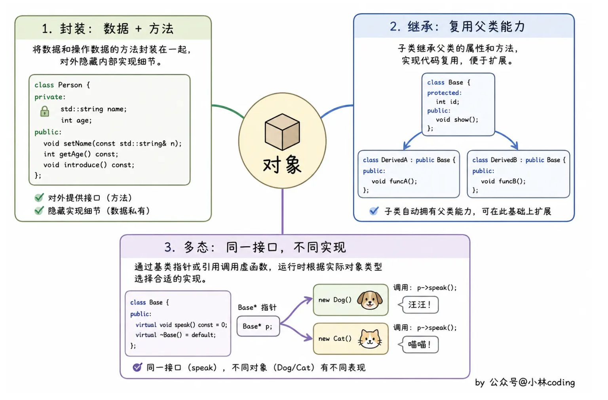

# 📘 15.1 OOP：概述 (OOP: An Overview)

> 来源说明：C++ Primer 第15章第1节 | 本节涵盖：面向对象的概念与三大特性（封装、继承、多态），以及数据抽象、继承与动态绑定的基础概述

---

## 🧠 核心概念总览（严格按原文顺序）

* [*知识点1: 面向对象的概念*](#id1)
* [*知识点2: 面向对象的三大特征*](#id2)
* [*知识点3: 继承(Inheritance)与类层次结构*](#id3)
* [*知识点4: 定价策略示例: Quote与Bulk_quote类*](#id4)
* [*知识点5: 成员函数设计——isbn与net_price*](#id5)
* [*知识点6: 虚函数(virtual)与类派生列表*](#id6)
* [*知识点7: Quote类代码定义*](#id7)
* [*知识点8: Bulk_quote类代码定义与公有继承*](#id8)
* [*知识点9: 派生类中的虚函数与override关键字*](#id9)
* [*知识点10: 动态绑定(Dynamic Binding)的概念*](#id10)
* [*知识点11: print_total函数示例与动态绑定应用*](#id11)
* [*知识点12: 运行时绑定(Run-time Binding)的原理*](#id12)
* [*知识点13: 动态绑定的触发条件*](#id13)

---

<a id="id1"></a>
## ✅ 知识点1: 面向对象的概念

**C++ 最常讲的三种编程范式**

1. **面向过程：围绕“要做哪些步骤”组织代码** 
   - 将任务拆成函数，再按流程调用函数来处理数据
    - 例如转账时，依次检查余额、扣款、入账
    - 重点是**函数和执行流程**
2. **面向对象编程（本章重点）**：**围绕对象组织程序，将相关的数据和操作放在一起，通过对象之间的协作完成功能**
    - **类**: 描述一类对象共有的数据和行为
   - **对象**: 是类的具体实例，例如：`Quote` 描述书籍报价，一份具体的报价就是一个 `Quote` 对象。
3. **泛型编程：围绕“同一套代码如何适用于多种类型”组织代码** 
    - 主要通过模板编写通用的类和算法，只要类型满足所需操作，就能复用
    - 例如 `std::vector<int>` 和 `std::vector<double>` 使用同一套容器模板；`std::sort` 能排序多种类型的元素。

---

<a id="id2"></a>
## ✅ 知识点2: 面向对象的三大特征

- 核心思想概括为三大特征：

  1. **数据抽象（Data Abstraction）**：
      - 分离接口与实现，让使用者关注“能做什么”
  2. **继承（Inheritance）**：
      - 组织相似类型之间的关系，建立类的层次结构
  3. **动态绑定（Dynamic Binding）**：
      - 我们可以在使用这些类型的对象时，忽略它们具体差异的细节


**三大核心思想的实现**

| 特性 | 核心含义 | 本章示例 |
|---|---|---|
| **封装（Encapsulation）** | 将数据和操作组织在类中，通过公开接口提供功能，隐藏内部实现细节 | `Quote` 将书号 `bookNo` 设为私有，通过 `isbn()` 获取 |
| **继承（Inheritance）** | 在已有类的基础上定义新类，复用共同部分，并扩展自身特有的行为 | `Bulk_quote` 继承 `Quote`，增加批量购买的折扣规则 |
| **多态（Polymorphism）** | 使用统一接口操作不同继承类的对象，表现出不同的行为 | 通过 `Quote` 的引用调用虚函数 `net_price()`，普通报价和批量折扣报价采用各自的计算方式 |




**注意点**

* 💡 **记忆技巧**：封装隐藏细节，继承组织关系，多态统一接口。


---

<a id="id3"></a>
## ✅ 知识点3: 继承(Inheritance)与类层次结构

**理论**
* **核心主旨总结**：通过**继承**相关的类形成**层次结构(hierarchy)**
* **基类(Base class)**：通常层次结构的根部有一个基类，其他类（直接或间接地）从这个基类继承
* **派生类(Derived classes)**：这些继承而来的类被称为派生类
* **职责划分**：
  * 基类定义对整个层次结构中所有类型都共同的成员
  * 每个派生类定义特定于该类自身的成员

**注意点**
* ⚠️ **重点强调**：基类位于层次结构的根部，派生类继承自基类


---

<a id="id4"></a>
## ✅ 知识点4: 定价策略示例:`Quote`与`Bulk_quote`类

**理论**
* **核心主旨总结**：
    * 为模型化不同的定价策略，定义一个名为`Quote`的类作为层次结构的基类
* **`Quote`类**：代表不打折的书籍，是层次结构的基类
* **`Bulk_quote`类**：继承自`Quote`，代表可以按数量折扣销售的书籍

**注意点**
* 💡 **理解技巧**：这是典型的"一般-特殊"关系——`Quote`是一般情况（原价），`Bulk_quote`是特殊情况（批量折扣）
* 🔄 **知识关联**：**这展示了继承的"is-a"关系**：`Bulk_quote`是一种(is a)`Quote`

---

<a id="id5"></a>
## ✅ 知识点5: 成员函数设计: `isbn`与`net_price`

**理论**
* **核心主旨总结**：这些类将包含以下两个成员函数，分别处理不同类型的操作：
* **`isbn()`**：返回`ISBN`号码
  * 此操作不依赖于继承类的具体细节
  * 仅在`Quote`类中定义一次
* **`net_price(size_t)`**：返回购买指定数量书籍的价格
  * 此操作是**类型特定**的
  * `Quote`和`Bulk_quote`都将定义自己的版本

**注意点**
* ⚠️ **关键区别**：`isbn`与类型无关（所有书籍都有ISBN），而`net_price`与类型相关（不同定价策略计算不同）


---

<a id="id6"></a>
## ✅ 知识点6: 虚函数(virtual)与类派生列表

**理论**
* **核心主旨总结**：
    * 在C++中，基类需要区分: 
        * **类型相关的函数**
        * 和**期望派生类直接继承而不改变的函数**
* **虚函数(virtual functions)**：基类将期望派生类自行定义的函数声明为`virtual`
* **类派生列表(Class derivation list)**：派生类必须指定它要继承的类，形式为冒号后跟逗号分隔的基类列表，每个基类可有可选的访问说明符

**注意点**
* ⚠️ **语法要点**：`virtual`关键字只在基类声明中需要，在派生类中可选（建议显式标注）
* ⚠️ **继承语法**：派生类定义时，类名后接`: 访问说明符 基类名`

**教材示例代码**
```cpp
class Quote {
public:
    std::string isbn() const;
    virtual double net_price(std::size_t n) const;
};
```


---

<a id="id7"></a>
## ✅ 知识点7: `Quote`类代码定义

**理论**
* `Quote`类作为基类，定义了层次结构的公共接口，包括非虚函数`isbn`和虚函数`net_price`

**注意点**
* 💡 **设计原则**：将不变的接口放在基类，将可能变化的行为设为虚函数

**教材示例代码**
```cpp
class Quote {
public:
    std::string isbn() const;
    virtual double net_price(std::size_t n) const;
};
```

**代码解析**
  * `isbn()`是普通成员函数，所有派生类直接继承使用
  * `net_price()`被声明为`virtual`，期望派生类根据需要重写(override)


---

<a id="id8"></a>
## ✅ 知识点8: `Bulk_quote`类代码定义与公有继承

**理论**
* `Bulk_quote`类通过<b>公有继承(public inheritance)</b>继承自`Quote`类，并重写`net_price`函数
* **公有继承特性**：因为`Bulk_quote`在派生列表中使用了`public`，我们可以像使用`Quote`对象一样使用`Bulk_quote`对象

**注意点**
* ⚠️ **访问控制**：`public`继承意味着基类的公有成员在派生类中仍是公有的
* ⚠️ **"是一个"关系**：公有继承建立"is-a"关系，`Bulk_quote`是一种`Quote`


**教材示例代码**
```cpp
class Bulk_quote : public Quote { // Bulk_quote继承自Quote
public:
    double net_price(std::size_t) const override;
};
```


---

<a id="id9"></a>
## ✅ 知识点9: 派生类中的虚函数与`override`关键字

**理论**
* **必须报函虚函数**：派生类必须在类体中包含它要自行定义的所有虚函数的声明
* **`virtual`关键字可选**：派生类可以在这些函数中包含`virtual`关键字，但不是必需的
* **`override`关键字（C++11）**：新标准允许派生类显式注明它打算重写继承而来的虚函数，方法是在参数列表后指定`override`

**注意点**
* ⚠️ **最佳实践**：虽然`virtual`在派生类中可选，但**强烈建议使用`override`**，因为它能让编译器检查是否真的重写了基类虚函数
* ⚠️ **常见错误**：如果标记了`override`但函数签名不匹配，编译器会报错，这有助于捕获错误
* 💡 **理解技巧**：`override`是"显式意图"声明，提高代码可读性和安全性

---

<a id="id10"></a>
## ✅ 知识点10: 动态绑定(Dynamic Binding)的概念

**理论**
* 通过**动态绑定(dynamic binding)**，我们可以使用相同的代码交替处理`Quote`或`Bulk_quote`类型的对象
* **应用场景**：可以编写一个函数，该函数能统一处理基类和派生类对象，而无需关心对象的具体类型

**注意点**
* ⚠️ **核心机制**：动态绑定使得"一份代码，多种行为"成为可能
* 📋 **参数类型**：注意`item`参数是`const Quote&`（**基类引用**），这是动态绑定的关键
* 💡 **理解技巧**：这就像"按需分配"——传入什么类型对象，就调用该类型的版本

**教材示例代码**
```cpp
// 计算并打印给定数量的书籍的价格，应用任何折扣
double print_total(ostream &os,
                   const Quote &item, size_t n)
{
    // 根据绑定到item参数的对象类型
    // 调用Quote::net_price或Bulk_quote::net_price
    double ret = item.net_price(n);
    os << "ISBN: " << item.isbn() // 调用Quote::isbn
       << " # sold: " << n << " total due: " << ret << endl;
    return ret;
}
```

---

<a id="id11"></a>
## ✅ 知识点11: `print_total`函数示例与动态绑定应用

**理论**
* `print_total`函数展示了动态绑定的实际应用，虽然函数实现简单，但有两个值得注意的关键点

    1. **参数兼容性**：因为`item`参数是`Quote`的引用，我们可以用`Quote`对象或`Bulk_quote`对象调用此函数（参见15.2.3节）
    2. **虚函数调用**：因为`net_price`是虚函数，且`print_total`通过引用调用`net_price`，所以实际运行的`net_price`版本取决于传递给`print_total`的对象类型

**教材示例代码**
```cpp
// basic类型为Quote; bulk类型为Bulk_quote
print_total(cout, basic, 20); // 调用Quote版本的net_price
print_total(cout, bulk, 20);  // 调用Bulk_quote版本的net_price
```

**注意点**
* ⚠️ **第一次调用**：传递`Quote`对象给`print_total`，调用`net_price`时运行`Quote`版本
* ⚠️ **第二次调用**：传递`Bulk_quote`对象给`print_total`，调用`net_price`时运行`Bulk_quote`版本（应用折扣）


---

<a id="id12"></a>
## ✅ 知识点12: 运行时绑定的原理

**理论**
* **核心主旨总结**：因为决定运行哪个版本的决策依赖于参数的类型，而这个决策无法在编译期做出，必须在<b>运行时(run time)</b>才能确定
* **运行时绑定**：因此，动态绑定有时被称为**运行时绑定(run-time binding)**

**注意点**
* ⚠️ **关键区别**：静态绑定（编译期确定）vs 动态绑定（运行期确定）
* 💡 **理解技巧**：编译器在编译时不知道会传入什么对象，只有在程序运行、函数被调用时才能确定对象的真实类型


---

<a id="id13"></a>
## ✅ 知识点13: 动态绑定的触发条件

**理论**
* **核心主旨总结**：在C++中，当通过
    1. <b>基类的引用(reference)</b>
    2. 或<b>指针(pointer)**调用**虚函数(virtual function)</b>时，会发生动态绑定

**注意点**
* ⚠️ **三大条件**（必须同时满足）：
  1. 调用的是虚函数
  2. 通过基类引用或指针调用
  3. 实际对象是派生类对象
* ⚠️ **常见陷阱**：如果通过对象本身（而非引用/指针）调用虚函数，将不会发生动态绑定，而是调用该对象静态类型对应的版本
* 💡 **记忆要点**：引用/指针提供"间接性"，这是实现运行时多态的关键机制

---

## 🔑 核心要点总结

1. **面向对象的概念**：围绕对象组织程序；类描述共有的数据和行为，对象是类的具体实例
2. **面向对象三大特性**：封装隐藏细节，继承组织关系，多态统一接口；封装支持数据抽象，动态绑定实现运行时多态
3. **继承层次结构**：基类定义共同接口，派生类扩展特定功能，通过公有继承建立"is-a"关系
4. **虚函数机制**：基类用`virtual`声明期望派生类重写的函数，派生类用`override`显式标明重写意图
5. **动态绑定条件**：只有通过基类引用/指针调用虚函数时，才会在运行时根据实际对象类型决定调用哪个版本，实现"一份代码，多种行为"

## 📌 考试速记版

* **面向对象**：围绕对象组织程序；类描述共性，对象是类的具体实例。

* **三大特性**：封装隐藏细节，继承组织关系，多态统一接口。

* **关键语法**：
  * 基类虚函数：`virtual 返回类型 函数名(参数列表);`
  * 派生类重写：`返回类型 函数名(参数列表) const override;`
  * 公有继承：`class 派生类 : public 基类 { ... };`

* **重要对比**：

| 特性 | 静态绑定(编译期) | 动态绑定(运行期) |
|------|------------------|------------------|
| 调用方式 | 对象本身 | 基类引用/指针 |
| 函数类型 | 普通函数 | 虚函数(virtual) |
| 确定时机 | 编译时 | 运行时 |
| 灵活性 | 固定 | 根据实际对象类型 |

* **常见错误和陷阱**：
  * ❌ 忘记在基类中声明`virtual`——导致无法动态绑定
  * ❌ 使用对象而非引用/指针传递参数——切片问题(slicing)，丢失派生类特性
  * ❌ 派生类函数签名不匹配却标记`override`——编译错误
  * ❌ 在派生类中忘记`const`限定符——实际上没有重写，而是定义了新函数

**记忆口诀**：  
*"虚函数动态绑，引用指针才能行；基类声明派生写，override保准确；公有继承is-a，运行时定真类型。"*