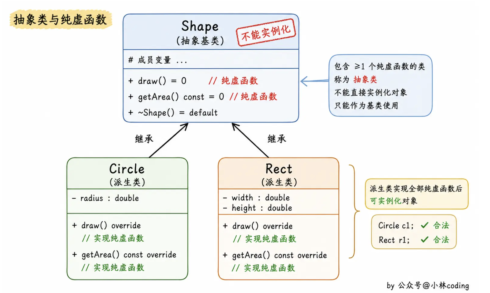

# 📘 15.2 定义基类和派生类 (Defining Base and Derived Classes)

> 来源说明：C++ Primer 第15.2节 | 本节涵盖：面向对象编程中基类与派生类的定义、继承关系建立、访问控制及类型转换规则

---

## 🧠 核心概念总览（严格按原文顺序）

* [*知识点1: 基类与派生类的定义概述*](#id1)
* [*知识点2: 定义基类 - Quote类示例*](#id2)
* [*知识点3: 虚析构函数的重要性*](#id3)
* [*知识点4: 成员函数与继承 - 虚函数与覆盖*](#id4)
* [*知识点5: 继承与访问控制 - protected访问说明符*](#id5)
* [*知识点6: 定义派生类 - 类派生列表*](#id6)
* [*知识点7: Bulk_quote类定义*](#id7)
* [*知识点8: 派生类继承基类成员*](#id8)
* [*知识点9: public继承与接口继承*](#id9)
* [*知识点10: 单继承概念*](#id10)
* [*知识点11: 派生类中的虚函数 - override关键字*](#id11)
* [*知识点12: 派生类对象与派生到基类的转换*](#id12)
* [*知识点13: Bulk_quote对象的概念结构*](#id13)
* [*知识点14: 派生类构造函数 - 基类初始化*](#id14)
* [*知识点15: 构造函数初始化顺序*](#id15)
* [*知识点16: 派生类使用基类成员*](#id16)
* [*知识点17: 关键概念 - 尊重基类接口*](#id17)
* [*知识点18: 继承与静态成员*](#id18)
* [*知识点19: 派生类的声明*](#id19)
* [*知识点20: 用作基类的类 - 直接基类与间接基类*](#id20)
* [*知识点21: 防止继承 - final说明符*](#id21)
* [*知识点22: 转换与继承概述*](#id22)
* [*知识点23: 静态类型与动态类型*](#id23)
* [*知识点24: 不存在从基类到派生类的隐式转换*](#id24)
* [*知识点25: 对象之间不存在转换 - 对象切割*](#id25)

---

<a id="id1"></a>
## ✅ 知识点1: 基类与派生类的定义概述

**理论**
* 基类和派生类在许多方面（但并非所有方面）的定义方式与其他类相似
* 本节涵盖用于定义继承相关类的基本特性
* **核心概念**：继承层次结构的根类几乎总是定义虚析构函数

---

<a id="id2"></a>
## ✅ 知识点2: 定义基类 - `Quote`类示例

**理论**
* **基类**定义了派生类共同拥有的接口(interface)
* 基类通过将成员函数声明为**虚函数**来指定派生类应该覆盖(override)哪些操作
* **`protected`访问说明符**：允许派生类访问但禁止其他用户访问
* 类作为继承层次的根时，通常需要虚析构函数以实现动态绑定

**注意点**
* 💡 **虚函数**：基类使用`virtual`关键字声明期望派生类覆盖的函数
* 💡 **`protected`成员**：`price`成员声明为`protected`，使派生类可以访问但外部代码不能访问
* 💡 **虚析构函数**：`virtual ~Quote() = default;` 确保通过基类指针删除派生类对象时能正确调用析构函数


**教材示例代码**
```cpp
class Quote {
public:
    Quote() = default;  // =default see § 7.1.4 (p. 264)
    Quote(const std::string &book, double sales_price):
          bookNo(book), price(sales_price) { }
    std::string isbn() const { return bookNo; }
    // returns the total sales price for the specified number of items
    // derived classes will override and apply different discount algorithms
    virtual double net_price(std::size_t n) const
        { return n * price; }
    virtual ~Quote() = default; // dynamic binding for the destructor
private:
    std::string bookNo; // ISBN number of this item
protected:
    double price = 0.0; // normal, undiscounted price
};
```


---

<a id="id3"></a>
## ✅ 知识点3: 虚析构函数的重要性

**理论**
* **基类通常应该定义虚析构函数**
* 即使虚析构函数不做任何工作，也是必需的
* 虚析构函数确保当通过基类指针删除派生类对象时，能够正确调用派生类的析构函数

**注意点**
* ⚠️ **重要警告**：如果基类没有虚析构函数，通过基类指针删除派生类对象会导致未定义行为


---

<a id="id4"></a>
## ✅ 知识点4: 成员函数与继承 - 虚函数与覆盖

**理论**
* **覆盖**：派生类需要提供自己的定义来覆盖从基类继承的定义，特别是那些类型相关的操作（如`net_price`）
* **虚函数**：基类通过在声明前加`virtual`关键字来指定期望派生类覆盖的函数。
* **动态绑定**：**通过指针或引用调用虚函数时**，调用将在运行时根据对象的实际类型决定，可能执行基类版本或派生类版本。
* **非虚函数**：没有被声明为virtual的成员函数在**编译时解析**，而不是运行时
    * 基类使用`virtual`关键字在函数声明内部（类定义内部），不能用于类外部的函数定义
    * 在基类中声明为`virtual`的函数在派生类中**隐式地**也是`virtual`的
* **纯虚函数**：虚函数在类中声明时，加上 `=0`，它在基类中没有定义，但要求任何派生类都要定义自己的实现方法
    * **含有纯虚函数的类称为抽象类**(只要含有纯虚函数这个类就是抽象类)
    * 继承纯虚函数的派生类，如果没有完全实现基类纯虚函数，依然是抽象类，不能实例化对象
    * 抽象类不能被实例化
    * 但是可以声明抽象类指针，可以声明抽象类的引用
    
* C++11标准允许派生类通过`override`关键字显式标记意图覆盖的虚函数
* **析构函数最好定义为虚函数，特别是对于含有继承关系的类**
    * 析构函数也可以定义为纯虚函数，此时其所在的类为抽象基类，不能创建实例化对象

**注意点**
* 📋 **`override`关键字**：放在参数列表之后，或const/引用限定符之后（如果是const或引用成员函数）
* 💡 纯虚函数的应用场景主要包括：
    * **设计模式**:例如在模板方法模式中，基类定义一个算法的骨架，而将一些步骤延迟到子类中
    * **接口定义**:可以创建一个只包含纯虚函数的抽象类作为接口

**教材示例代码**
```cpp
// 基类中的虚函数声明
virtual double net_price(std::size_t n) const { return n * price; }

// 派生类中的覆盖声明（见后续Bulk_quote示例）
double net_price(std::size_t) const override;

// 纯虚函数
virtual void function() = 0;
```

---

<a id="id5"></a>
## ✅ 知识点5: 继承与访问控制 - `protected`访问说明符

**理论**
* **访问控制与继承**：派生类继承基类定义的成员，但派生类中的成员函数不一定能访问继承的成员
* **`protected`访问说明符**：基类希望让派生类使用但禁止其他用户访问的成员应声明为`protected`
* 派生类可以访问基类的`public`成员，**但不能访问**`private`成员
* `Quote`类将`bookNo`声明为`private`（派生类只能通过isbn函数访问），将`price`声明为`protected`（允许派生类直接访问）

**注意点**
* 📋 **访问级别对比**：
  * **`public`**：所有代码都可访问
  * **`protected`**：派生类可访问，其他代码不可访问
  * **`private`**：只有类自身可访问

---

<a id="id6"></a>
## ✅ 知识点6: 定义派生类 - 类派生列表

**理论**
* 派生类必须通过<b>类派生列表(class derivation list)</b>指定继承自哪个（哪些）类
* 类派生列表的格式：冒号后跟逗号分隔的基类名列表
* 每个基类名前面可以加上可选的**访问说明符(access specifier)**：`public`、`protected`或`private`
* **访问说明符**：决定了基类成员到了派生类中后得到的访问权限，以及派生类用户是否知道继承关系
    * 如 `:private base` 表示 `base`类的`public`成员到了派生类都会定义为`private`

**注意点**
* 📋 **类派生列表(class derivation list)**：格式为 `: 访问说明符 基类名`


**教材示例代码**
```cpp
class Bulk_quote : public Quote { // Bulk_quote inherits from Quote
public:
    Bulk_quote() = default;
    Bulk_quote(const std::string&, double, std::size_t, double);
    // overrides the base version in order to implement the bulk purchase discount policy
    double net_price(std::size_t) const override;
private:
    std::size_t min_qty = 0; // minimum purchase for the discount to apply
    double discount = 0.0;   // fractional discount to apply
};
```


---

<a id="id7"></a>
## ✅ 知识点7: `Bulk_quote`类定义详解

**理论**
* `Bulk_quote`类继承自`Quote`基类
* 它定义了自己的`net_price`成员来覆盖基类版本，实现批量购买折扣策略
* 新增两个数据成员：`min_qty`（享受折扣的最低购买量）和`discount`（折扣比例，以分数形式存储）
* `Bulk_quote`继承了`isbn`函数以及`bookNo`和`price`数据成员

**注意点**
* ⚠️ **覆盖标记**：`override`关键字明确表示该函数意图覆盖基类的虚函数
* 💡 **新增成员**：派生类可以定义基类中没有的数据成员和成员函数

**教材示例代码**
```cpp
class Bulk_quote : public Quote {
public:
    Bulk_quote() = default;
    Bulk_quote(const std::string&, double, std::size_t, double);
    double net_price(std::size_t) const override;
private:
    std::size_t min_qty = 0;
    double discount = 0.0;
};
```


---

<a id="id8"></a>
## ✅ 知识点8: 派生类继承基类成员

**理论**
* `Bulk_quote`类继承了`Quote`的`isbn`函数以及`bookNo`和`price`数据成员
* 派生类自动获得基类的成员（除了构造函数和赋值运算符等特殊成员）
* 派生类只需定义与基类不同的行为或新增的成员

**注意点**
* 📋 **继承内容**：派生类继承基类的数据成员和成员函数，但**不继承构造函数**
* 💡 **代码复用**：继承机制避免了重复定义共同成员

---

<a id="id9"></a>
## ✅ 知识点9: `public`继承与接口继承

**理论**
* 当派生是**public**时，基类的`public`成员成为派生类接口的一部分
* **派生类绑定到基类**：可将派生类对象的指针或引用绑定到基类类型的指针或引用上
* 由于使用了`public`继承，`Bulk_quote`的接口隐式包含`isbn`函数
* 在需要`Quote`的指针或引用的地方，可以使用`Bulk_quote`对象

**注意点**
* 📋 **`public`继承**：表示"是一个(is-a)"关系，`Bulk_quote`是一个`Quote`
* 💡 **接口继承**：派生类继承了基类的公共接口


---

<a id="id10"></a>
## ✅ 知识点10: 单继承概念

**理论**
* **单继承**：大多数类只直接继承自一个基类
* 本章主题就是这种单继承形式
* 第18.3节将讲解继承列表中有多个基类的类（多重继承）


---

<a id="id11"></a>
## ✅ 知识点11: 派生类中的虚函数 - `override`关键字

**理论**
* 派生类经常（但不总是）覆盖继承的虚函数
* 如果派生类不覆盖某个虚函数，它将继承基类中定义的版本
* C++11允许派生类使用`virtual`关键字标记覆盖的函数，但不是必须的
* **`override`说明符**：新标准允许派生类显式标记它意图覆盖的虚函数

**注意点**
* 📋 **`override`**：放在参数列表之后，或const/引用限定符之后
* 💡 **显式标记**：使用`override`可以帮助编译器检查是否真的覆盖了基类虚函数，避免拼写错误或签名不匹配导致的意外
* 🔄 **知识关联**：第15.3节将解释使用`override`的原因

---

<a id="id12"></a>
## ✅ 知识点12: 派生类对象与派生到基类的转换

**理论**
* **派生类对象**包含多个部分：
    * 一个包含派生类自身定义的非静态成员的子对象
    * 和对应于每个基类的子对象
* 虽然标准不指定派生对象在内存中的布局方式，但可以将`Bulk_quote`对象看作由两部分组成：
    * 继承自`Quote`的`bookNo`和`price`，
    * 以及自己定义的`min_qty`和`discount`
* 因为派生对象包含对应于其基类的子对象，可以将派生类型对象用作其基类型对象
* 可以将基类引用或指针绑定到派生对象的基类部分

**注意点**
* 📋 **派生到基类转换(derived-to-base conversion)**：这种转换通常被称为派生到基类的转换
* 💡 **隐式转换**：编译器会隐式应用派生到基类转换
* ⚠️ **重要概念**：基类引用或指针的静态类型可能与动态类型不同

**教材示例代码**
```cpp
Quote item;         // object of base type
Bulk_quote bulk;    // object of derived type
Quote *p = &item;   // p points to a Quote object
p = &bulk;          // p points to the Quote part of bulk
Quote &r = bulk;    // r bound to the Quote part of bulk
```


---

<a id="id13"></a>
## ✅ 知识点13: `Bulk_quote`对象的概念结构

**理论**
* 基类和派生部分**不保证**在内存中连续存储，这里只讲概念性表示而非物理表示
* 这种包含关系是理解继承如何工作的关键

**注意点**

* 💡 **关键理解**：派生对象包含基类子对象是继承工作机制的核心
* 📋 **子对象(subobject)**：派生对象中嵌入的基类部分

---

<a id="id14"></a>
## ✅ 知识点14: 派生类构造函数 - 基类初始化

**理论**
* 派生类不能直接初始化从基类继承的成员
* 派生类必须使用<b>基类构造函数(base-class constructor)</b>来初始化其基类部分
* 类似于成员初始化，派生类构造函数使用<b>构造函数初始化列表(constructor initializer list)</b>向基类构造函数传递参数
* 每个类控制其成员的初始化方式

**教材示例代码**
```cpp
Bulk_quote(const std::string& book, double p,
           std::size_t qty, double disc) :
           Quote(book, p), min_qty(qty), discount(disc) { }
// as before
};
```

**注意点**
* 📋 **构造函数初始化列表**：使用基类名`Quote(book, p)`来调用基类构造函数
* 💡 **初始化过程**：基类构造函数初始化`Bulk_quote`的基类部分（即`bookNo`和`price`成员）
* ⚠️ **关键规则**：派生类构造函数体中不能对基类成员赋值，必须在初始化阶段通过基类构造函数完成

---

<a id="id15"></a>
## ✅ 知识点15: 构造函数初始化顺序

**理论**
* 基类部分在构造函数初始化阶段与派生类的数据成员一起初始化
* **初始化顺序**：基类首先初始化，然后派生类成员按类中声明的顺序初始化
    * 构造函数初始化列表将前两个参数（`ISBN`和价格）传递给`Quote`构造函数
    * `Quote`构造函数初始化`Bulk_quote`的基类部分
    * 当`Quote`构造函数体完成（空函数体），基类部分初始化完成
    * 然后初始化直接成员`min_qty`和`discount`
    * 最后运行`Bulk_quote`构造函数体（空函数体）


**注意点**
* ⚠️ **初始化顺序**：基类构造函数总是在派生类成员之前调用
* 📋 **成员初始化顺序**：派生类成员按它们在类中声明的顺序初始化，而非初始化列表中的顺序
* 💡 **默认初始化**：除非另有说明，基类部分会被默认初始化

---

<a id="id16"></a>
## ✅ 知识点16: 派生类使用基类成员

**理论**
* 派生类可以访问基类的`public`和`protected`成员
* 派生类的作用域嵌套在基类作用域内
* 使用基类成员时没有区别，无论成员是在派生类中定义还是从基类继承

**教材示例代码**
```cpp
// if the specified number of items are purchased, use the discounted price
double Bulk_quote::net_price(size_t cnt) const
{
    if (cnt >= min_qty)
        return cnt * (1 - discount) * price;
    else
        return cnt * price;
}
```

**注意点**
* 💡 **作用域嵌套**：派生类的作用域嵌套在基类作用域内，因此派生类可以像使用自己定义的成员一样使用基类成员（如`price`）
* 📋 **访问权限**：可以访问`public`和`protected`基类成员，不能访问`private`成员
* 🔄 **知识关联**：第15.6节将详细介绍作用域

---

<a id="id17"></a>
## ✅ 知识点17: 关键概念 - 尊重基类接口

**理论**
* **尊重基类接口**是面向对象设计的关键概念
* 每个类定义自己的接口
* 与类类型对象的交互应该使用该类的接口，即使该对象是派生对象的基类部分
* **重要原则**：派生类构造函数不能直接初始化基类成员，派生类构造函数体可以给基类的`public`或`protected`成员赋值，但通常不应该这样做
* 派生类应该像基类的任何其他用户一样，**使用构造函数**来初始化继承的成员

**注意点**
* ⚠️ **设计原则**：通过构造函数初始化继承成员，而非在构造函数体内赋值
* 💡 **封装维护**：尊重基类的封装，使用其提供的接口

---

<a id="id18"></a>
## ✅ 知识点18: 继承与静态成员

**理论**
* 如果基类定义了**静态成员(static member)**，整个继承层次中只有该成员的唯一定义
* 无论有多少类从基类派生，每个静态成员只有单一实例
* 静态成员遵循正常的访问控制
* 如果静态成员在基类中是`private`的，派生类无法访问它
* 如果成员可访问，可以通过基类或派生类访问静态成员

**注意点**
* 📋 **静态成员**：属于类本身，而非类的某个对象
* 💡 **唯一性**：在整个继承层次中，静态成员只有一个实例

**教材示例代码**
```cpp
class Base {
public:
    static void statmem();
};
class Derived : public Base {
    void f(const Derived&);
};

void Derived::f(const Derived &derived_obj)
{
    Base::statmem();      // ok: Base defines statmem
    Derived::statmem();   // ok: Derived inherits statmem
    // ok: derived objects can be used to access static from base
    derived_obj.statmem(); // accessed through a Derived object
    statmem();            // accessed through this object
}
```


---

<a id="id19"></a>
## ✅ 知识点19: 派生类的声明

**理论**
* 派生类的声明与其他类声明类似:
    * 如果只做派生类的声明就只能包含类名，但**不能包含其派生列表**
    * 如果要标明派生列表的话，类定义的所有其他细节必须一起出现在**类体中**

**注意点**
* ⚠️ **常见错误**：前置声明派生类时不能包含派生列表
* 📋 **限制原因**：每个派生类会包含或使用从基类继承而来的的成员，为了使用他们，必须知道成员具体是什么

**教材示例代码**
```cpp
class Bulk_quote : public Quote; // error: derivation list can't appear here
class Bulk_quote;                // ok: right way to declare a derived class
```


---

<a id="id20"></a>
## ✅ 知识点20: 用作基类的类 - 直接基类与间接基类

**理论**
* 类必须先定义，而不仅仅是声明，才能用作基类
* 每个派生类包含并可能使用从基类继承的成员，为了使用这些成员，派生类必须知道它们是什么
* **重要限制**：
    * 类不能从自身派生
    * 基类本身也可以是派生类
* **直接基类(direct base)**：在派生列表中命名的基类
* **间接基类(indirect base)**：派生类通过其直接基类继承的基类
    * 每个类继承其直接基类的所有成员
* <b>最派生类(most derived class)</b>继承直接基类的成员，直接基类又继承其基类的成员，依此类推
* 最派生对象包含直接基类的子对象，以及每个间接基类的子对象

**教材示例代码**
```cpp
class Base { /* ... */ };
class D1: public Base { /* ... */ };
class D2: public D1 { /* ... */ };
```

**注意点**
* 📋 **直接基类(direct base)**：在派生列表中明确指定的基类（如D1的Base）
* 📋 **间接基类(indirect base)**：通过直接基类继承的基类（如D2的Base，通过D1继承）
* ⚠️ **定义要求**：基类必须是完整定义的，不能只是前置声明

---

<a id="id21"></a>
## ✅ 知识点21: 防止继承 - final说明符

**理论**
* 有时我们定义不希望其他类继承的类，或者不想考虑是否适合作为基类的类
* 在C++11标准下，可以通过在类名后添加`final`来防止类被用作基类

**注意点**
* 📋 **final说明符**：C++11引入，阻止类被继承
* 💡 **应用场景**：当类的设计不适合被继承，或需要防止进一步派生时使用

**教材示例代码**
```cpp
class NoDerived final { /*  */ }; // NoDerived can't be a base class
class Base { /*  */ };
// Last is final; we cannot inherit from Last
class Last final : Base { /*  */ }; // Last can't be a base class
class Bad : NoDerived { /*  */ };   // error: NoDerived is final
class Bad2 : Last { /*  */ };       // error: Last is final
```


---

<a id="id22"></a>
## ✅ 知识点22: 转换与继承概述

**理论**
* **转换与继承(Conversions and Inheritance)**：理解基类与派生类之间的转换对于理解C++中面向对象编程的工作方式至关重要
* 通常，只能将引用或指针绑定到与引用或指针类型相同的对象，或涉及可接受`const`转换的类型
* **重要例外**：继承相关的类允许将基类类型的指针或引用绑定到派生类类型的对象
    * **`Bulk_quote`** 可以传给 **`Quote*`** 或 **`Quote&`**（派生类转基类，安全）


**注意点**
* ⚠️ **重要警告**：理解基类与派生类之间的转换对于理解C++面向对象编程至关重要
* 💡 **灵活性**：这种转换允许编写处理基类对象的通用代码，这些代码也能透明地处理派生类对象

---

<a id="id23"></a>
## ✅ 知识点23: 静态类型与动态类型

**理论**
* 使用继承相关的类型时，需要区分表达式的**静态类型**和**动态类型**
    * **静态类型**：变量声明时的类型或表达式产生的类型，在编译时已知
    * **动态类型**：变量或表达式在内存中表示的对象的实际类型，直到运行时才能知道
* 当`print_total`调用`net_price`时，我们知道`item`的静态类型是`Quote&`
* 动态类型取决于绑定到`item`的参数类型，直到运行时调用执行时才能知道
* 如果传递`Bulk_quote`对象给`print_total`，`item`的静态类型是`Quote&`，但动态类型是`Bulk_quote`
* 既不是指针也不是引用的表达式的动态类型总是与其静态类型相同

**注意点**
* 📋 **静态类型(static type)**：编译时确定的类型
* 📋 **动态类型(dynamic type)**：运行时确定的实际对象类型
* ⚠️ **关键理解**：基类指针或引用的静态类型可能与其动态类型不同，这是实现多态的基础

**教材示例代码**
```cpp
// 示例调用场景
double ret = item.net_price(n);
// item的静态类型是Quote&
// 如果传入Bulk_quote对象，动态类型是Bulk_quote
```

---

<a id="id24"></a>
## ✅ 知识点24: 不存在从基类到派生类的隐式转换

**理论**
* 之所以存在从派生类到基类的转换，是因为每个派生对象都包含一个基类部分，基类指针或引用可以绑定到该部分
    * 但是对于基类对象，没有类似的保证
    * 基类对象可能是独立对象，也可能是派生对象的一部分
    * 不是派生对象一部分的基类对象只有基类定义的成员，没有派生类定义的成员
* 因为基类对象可能不是派生对象的一部分，所以**不存在从基类到其派生类的自动转换**
* 即使基类指针或引用绑定到派生对象之后，也不能从基类转换回派生类，原因如下：
    * 编译器在编译时无法知道特定转换在运行时是否安全
    * 编译器只看指针或引用的静态类型来确定转换是否合法
* 如果基类有一个或多个虚函数，可以使用<b>`dynamic_cast`</b>请求运行时检查的转换
    * 如果确定从基类到派生类的转换是安全的，可以使用

**注意点**
* ⚠️ **重要限制**：不存在从基类到派生类的隐式转换
* ⚠️ **安全问题**：即使基类指针实际指向派生对象，也不能隐式转换为派生指针，因为编译器无法验证
* 📋 **`dynamic_cast`**：运行时类型检查转换，安全但有一定开销
* 📋 **`static_cast`**：编译时强制转换，不安全但可用于已知安全的情况

**教材示例代码**
```cpp
Quote base;
Bulk_quote* bulkP = &base;   // error: can't convert base to derived
Bulk_quote& bulkRef = base;  // error: can't convert base to derived

Bulk_quote bulk;
Quote *itemP = &bulk;        // ok: dynamic type is Bulk_quote
Bulk_quote *bulkP = itemP;   // error: can't convert base to derived
```


---

<a id="id25"></a>
## ✅ 知识点25: 对象之间不存在转换 - 对象切割

**理论**
* **自动的派生到基类转换只适用于指针或引用类型**，不存在从派生类类型到基类类型的对象转换
* 但可以将派生类对象转换为基类类型对象，只是这种行为可能不符合预期，原因如下: 
    * 初始化或赋值类类型对象时，实际上是在调用函数
    * 初始化时调用构造函数，赋值时调用赋值运算符
    * 这些成员通常有接受const版本类类型引用的参数
    * 因为接受引用，派生到基类转换允许将派生对象传递给基类的拷贝/移动操作
    * 这些操作不是虚的
    * 当传递派生对象给基类构造函数时，运行的是基类定义的构造函数，它只知道基类本身的成员
    * 当将派生对象赋值给基类对象时，运行的也是基类定义的赋值运算符，同样只知道基类成员
    * 因此，当`item`被构造时，运行`Quote`拷贝构造函数，它只复制`bookNo`和`price`，忽略`Bulk_quote`部分
    * 将`bulk`赋值给`item`时，只赋值`Quote`部分
    * 因为`Bulk_quote`部分被忽略，我们说`Bulk_quote`部分被<b>切割(sliced down)</b>了

**注意点**
* ⚠️ **重要警告**：当用派生类型对象初始化或赋值基类型对象时，只拷贝、移动或赋值基类部分，派生部分被忽略
* 📋 **对象切割(object slicing)**：将派生对象赋值给基类对象时，派生部分被"切掉"的现象
* ⚠️ **常见陷阱**：这通常不是期望的行为，应避免通过值传递派生对象给基类参数

**教材示例代码**
```cpp
Bulk_quote bulk;     // object of derived type
Quote item(bulk);    // uses the Quote::Quote(const Quote&) constructor
item = bulk;         // calls Quote::operator=(const Quote&)
```


---

## 🔑 核心要点总结

1. **虚函数与动态绑定**：基类通过`virtual`关键字声明期望派生类覆盖的函数，通过基类指针/引用调用时实现运行时多态，这是面向对象编程的核心机制。

2. **访问控制三层次**：`public`（所有代码可访问）、`protected`（派生类可访问）、`private`（仅类自身可访问），合理选择访问级别是封装设计的关键。

3. **派生类构造函数规则**：派生类必须通过构造函数初始化列表调用基类构造函数来初始化基类部分，基类总是先于派生类成员初始化。

4. **类型转换方向性**：存在**派生到基类**的隐式转换（指针/引用），但**不存在基类到派生类**的隐式转换，对象间赋值会导致派生部分被切割。

5. **静态类型 vs 动态类型**：基类指针/引用的静态类型可能与动态类型不同，这是实现多态的基础，也是理解C++对象模型的关键概念。

## 📌 考试速记版

| 概念 | 要点 | 注意 |
|------|------|------|
| **虚函数** | `virtual`修饰，支持动态绑定 | 基类通常需要虚析构函数 |
| **覆盖(override)** | 派生类重写基类虚函数 | C++11用`override`显式标记 |
| **protected** | 派生类可访问，外部不可 | 介于public和private之间 |
| **派生列表** | `: public Base` | 声明时不能带派生列表 |
| **构造函数** | 先初始化基类，再初始化成员 | 使用初始化列表调用基类构造函数 |
| **静态成员** | 整个继承层次只有一个实例 | 可通过基类或派生类访问 |
| **final** | 阻止类被继承 | C++11特性，放在类名后 |
| **派生→基类** | 指针/引用可隐式转换 | 对象转换会切割派生部分 |
| **基类→派生** | 不存在隐式转换 | 可用dynamic_cast或static_cast |
| **对象切割** | 派生对象赋值给基类对象时发生 | 只复制基类部分，派生部分丢失 |

**记忆口诀**：
- **虚函数实现多态**：虚基多态靠指针，引用也能来绑定
- **构造先基后成员**：初始化列表调基构，先基后员记清楚
- **转换单向不可逆**：派生转基可隐式，基转派生要强制
- **对象赋值要当心**：赋值切割派生部，指针引用才保持

**常见陷阱**：
- ❌ 忘记在基类中声明虚析构函数
- ❌ 试图在派生类构造函数体内初始化基类成员
- ❌ 期望派生对象赋值给基类对象时保留派生部分信息
- ❌ 混淆静态类型和动态类型的区别