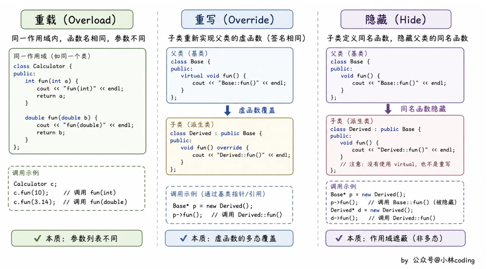

# 📘 15.6 继承下的类作用域 (Class Scope under Inheritance)

> 来源说明：C++ Primer 第15章第6节；补充：[小林coding：重载、重写、隐藏的区别是什么？](https://www.xiaolincoding.com/interview/cpp.html#重载、重写、隐藏的区别是什么) | 本节涵盖：类作用域的嵌套关系、名字查找机制、名字隐藏规则、作用域运算符的使用、虚函数与作用域、重载函数的覆盖、重载与重写及隐藏的对比

---

## 🧠 核心概念总览（严格按原文顺序）

* [*知识点1: 类作用域的嵌套关系*](#id1)
* [*知识点2: 名字解析示例：isbn的查找过程*](#id2)
* [*知识点3: 名字查找发生在编译时*](#id3)
* [*知识点4: 名字冲突与继承*](#id4)
* [*知识点5: 使用作用域运算符访问隐藏成员*](#id5)
* [*知识点6: 最佳实践*](#id6)
* [*知识点7: 关键概念 - 名字查找与继承*](#id7)
* [*知识点8: 名字查找发生在类型检查之前*](#id8)
* [*知识点9: 虚函数与作用域*](#id9)
* [*知识点10: 通过基类调用隐藏的虚函数*](#id10)
* [*知识点11: 覆盖重载函数*](#id11)
* [*知识点12: 重载、重写与隐藏的区别*](#id12)

---

<a id="id1"></a>
## ✅ 知识点1: 类作用域的嵌套关系

**理论**
* 每个类定义自己的**作用域**，在其作用域内定义成员
* 在继承体系下，<b>派生类</b>的作用域**嵌套**在其**基类**的作用域内
* **名字查找规则**：如果在派生类作用域内某个名字未解析成功，编译器会继续在外层包围的基类作用域中搜索该名字的定义
* **关键机制**：正是这种类作用域的层次嵌套，允许派生类成员像使用自身成员一样使用基类成员

**注意点**
* ⚠️ 事实：尽管基类和派生类在程序文本中定义在不同部分，但派生类作用域确实嵌套在基类作用域内
* 💡 **理解技巧**：将继承想象成"俄罗斯套娃"结构，内层（派生类）可以看到外层（基类），但反之不行

**教材示例代码**
```cpp
Bulk_quote bulk;
cout << bulk.isbn();
```

---

<a id="id2"></a>
## ✅ 知识点2: 名字解析示例：`isbn`的查找过程

**理论**
* 名字`isbn`的解析遵循以下步骤：
  1. 由于我们在`Bulk_quote`类型的对象上调用`isbn`，搜索从`Bulk_quote`类开始。在该类中未找到`isbn`名字
  2. 由于`Bulk_quote`继承自`Disc_quote`，接下来搜索`Disc_quote`类。仍未找到该名字
  3. 由于`Disc_quote`继承自`Quote`，接下来搜索`Quote`类。在该类中找到`isbn`名字；`isbn`的使用被解析为`Quote`中的`isbn`

**注意点**
* 🔄 **知识关联**：这个过程展示了§2.2.4(p. 48)中提到的嵌套作用域名字查找规则在继承中的应用


---

<a id="id3"></a>
## ✅ 知识点3: 名字查找发生在编译时

**理论**
* **静态类型**（§15.2.3, p. 601）通过名字查找决定对象的哪些成员可见（编译阶段）
* 即使<b>静态类型</b>和<b>动态类型</b>可能不同（如使用基类指针或引用时），**静态类型**决定哪些成员可以被使用
* **关键限制**：
    * 成员只能通过**该类型的对象**、指针或引用
    * 或该类型**派生类的对象**、指针或引用来使用
    * 但是不能通过基类指针，引用或对象访问派生类特有的成员。


**教材示例代码**
```cpp
class Disc_quote : public Quote {
public:
    std::pair<size_t, double> discount_policy() const
        { return {quantity, discount}; }
    // other members as before
};
```

**使用示例**
```cpp
Bulk_quote bulk;
Bulk_quote *bulkP = &bulk;  // static and dynamic types are the same
Quote *itemP = &bulk;       // static and dynamic types differ
bulkP->discount_policy();   // ok: bulkP has type Bulk_quote*
itemP->discount_policy();   // error: itemP has type Quote*
```

**代码解析**
* **重要限制**：即使`bulk`确实有一个名为`discount_policy`的成员，该成员对`itemP`不可见。
* **原因分析**：
    * `itemP`的类型是`Quote*`，这意味着对`discount_policy`的搜索从`Quote`类开始。
    * `Quote`类没有名为`discount_policy`的成员，因此不能通过`Quote`类型的对象、引用或指针调用该成员。


---

<a id="id4"></a>
## ✅ 知识点4: 名字冲突与继承

**理论**
* 与其他作用域一样，派生类可以重用其直接或间接基类中定义的名字
* **隐藏规则**：内层作用域（如派生类）中定义的名字会隐藏外层作用域（如基类）中该名字的使用（§2.2.4, p. 48）

**教材示例代码**
```cpp
struct Base {
    Base(): mem(0) { }
protected:
    int mem;
};
struct Derived : Base {
    Derived(int i): mem(i) { }  // initializes Derived::mem to i
                                // Base::mem is default initialized
    int get_mem() { return mem; }  // returns Derived::mem
protected:
    int mem;  // hides mem in the base
};
Derived d(42);
cout << d.get_mem() << endl;  // prints 42
```

**注意点**
* ⚠️ 派生类成员如果与基类成员同名，会隐藏对基类成员的直接使用。

---

<a id="id5"></a>
## ✅ 知识点5: 使用作用域运算符访问隐藏成员

**理论**
* 可以使用**作用域运算符**来访问被隐藏的基类成员
* 作用域运算符覆盖正常的查找规则，指示编译器从`Base`类的作用域开始查找`mem`

**教材示例代码**
```cpp
struct Derived : Base {
    int get_base_mem() { return Base::mem; }
    // ...
};
```

**注意点**
* 💡 **理解技巧**：`Base::mem`明确告诉编译器"**从Base类开始找mem，不要从当前类开始**"
* ⚠️ **行为差异**：如果使用这个版本的`Derived`，运行`d.get_mem()`的结果将是`0`（因为返回的是`Base::mem`的默认值，而不是`Derived::mem`的值）


---

<a id="id6"></a>
## ✅ 知识点6: 最佳实践

**理论**
* <b>Best Practices</b>：
    * 除了覆盖继承的虚函数外，派生类通常**不应该**重用其基类中定义的名字。
    * 保持名字的唯一性，避免在继承层次中重复使用相同名字（除非是虚函数覆盖）。


**注意点**
* ⚠️ **重要警告**：名字重用虽然语法上允许，但会导致代码难以理解和维护，容易引发混淆


---

<a id="id7"></a>
## ✅ 知识点7: 关键概念 - 名字查找与继承

**理论**

* 给定调用`p->mem()`（或`obj.mem()`），发生以下四个步骤：
  1. **确定静态类型**：首先确定`p`（或`obj`）的静态类型。由于我们调用成员，该类型必须是类类型
  2. **查找名字**：
        * 在对应于`p`（或`obj`）静态类型的类中查找`mem`。
        * 如果`mem`未找到，在直接基类中查找并继续向上搜索类链，直到找到`mem`或搜索到最后一个类。
        * 如果在类或其封闭基类中都未找到`mem`，则调用无法编译
        * 如果找到，最后找到候选函数集合
  3. **重载决议**：用实参匹配候选函数，选出最佳匹配函数
  4. **类型检查**：一旦找到`mem`，进行常规类型检查（§6.1, p. 203），查看给定找到的定义此调用是否合法
  5. **代码生成**：假设调用合法，编译器生成代码，根据调用是否为虚调用而不同：
     - 如果`mem`是**虚函数且通过引用或指针进行调用**，编译器生成代码以在运行时根据对象的动态类型对应关系决定运行哪个版本（**动态绑定**）
     - 否则（函数非虚，或调用通过对象而非引用/指针），编译器生成常规函数调用

**注意点**
* 🔄 **知识关联**：这个过程解释了为什么静态类型如此重要，以及虚函数调用的特殊机制


---

<a id="id8"></a>
## ✅ 知识点8: 名字查找发生在类型检查之前

**理论**
* 如我们所见，在内层作用域声明的函数不会**重载**在外层作用域声明的函数（§6.4.1, p. 234）
* **重要结论**：在派生类中定义的函数**不会重载**在其基类中定义的成员
* **隐藏规则详述**：与其他任何作用域一样，如果派生类成员（即内层作用域）与基类成员（即外层作用域中定义的名字）同名，则派生成员在派生类作用域内隐藏基类成员
* **关键细节**：即使函数具有不同的**参数列表**，基类成员仍然被隐藏

**教材示例代码**
```cpp
struct Base {
    int memfcn();
};
struct Derived : Base {
    int memfcn(int);  // hides memfcn in the base
};
Derived d; Base b;
b.memfcn();      // calls Base::memfcn
d.memfcn(10);    // calls Derived::memfcn
d.memfcn();      // error: memfcn with no arguments is hidden
d.Base::memfcn(); // ok: calls Base::memfcn
```

**注意点**
* ⚠️ **常见陷阱**：`d.memfcn()`调用是非法的！虽然`Base`中有无参版本，但`Derived`中的`memfcn(int)`隐藏了它
* ⚠️ **查找停止机制**：一旦在`Derived`中找到名字`memfcn`，编译器就不再继续查找。`Derived`中的版本期望`int`参数，此调用未提供参数，因此报错
* 💡 **解决方式**：使用`d.Base::memfcn()`明确调用基类版本

---

<a id="id9"></a>
## ✅ 知识点9: 虚函数与作用域

**理论**
* 我们现在可以理解为什么**虚函数**必须在基类和派生类中具有相同的参数列表（§15.3, p. 605）。
* **原因分析**：如果基类和派生类成员的参数列表不同，就**无法**通过基类的引用或指针调用派生类版本。

**教材示例代码**
```cpp
class Base {
public:
    virtual int fcn();
};
class D1 : public Base {
public:
    // hides fcn in the base; this fcn is not virtual
    // D1 inherits the definition of Base::fcn()
    int fcn(int);      // parameter list differs from fcn in Base
    virtual void f2(); // new virtual function that does not exist in Base
};
class D2 : public D1 {
public:
    int fcn(int);  // nonvirtual function hides D1::fcn(int)
    int fcn();     // overrides virtual fcn from Base
    void f2();     // overrides virtual f2 from D1
};
```

**注意点**
* ⚠️ **关键区别**：`D1`中的`fcn(int)`不覆盖`Base`中的虚`fcn()`，因为参数列表不同。相反，它**隐藏**了基类中的`fcn`
* ⚠️ **实际效果**：`D1`实际上有两个名为`fcn`的函数：一个是从`Base`继承的虚函数`fcn()`，另一个是自定义的非虚成员`fcn(int)`


---

<a id="id10"></a>
## ✅ 知识点10: 通过基类调用隐藏的虚函数

**理论**
* 基于上述类层次，探讨几种不同的函数调用方式

**教材示例代码**
```cpp
Base bobj;   D1 d1obj;   D2 d2obj;
Base *bp1 = &bobj, *bp2 = &d1obj, *bp3 = &d2obj;
bp1->fcn();  // virtual call, will call Base::fcn at run time
bp2->fcn();  // virtual call, will call Base::fcn at run time
bp3->fcn();  // virtual call, will call D2::fcn at run time

D1 *d1p = &d1obj; D2 *d2p = &d2obj;
bp2->f2();   // error: Base has no member named f2
d1p->f2();   // virtual call, will call D1::f2() at run time
d2p->f2();   // virtual call, will call D2::f2() at run time
```

**非虚函数调用示例**
```cpp
Base *p1 = &d2obj; D1 *p2 = &d2obj; D2 *p3 = &d2obj;
p1->fcn(42);  // error: Base has no version of fcn that takes an int
p2->fcn(42);  // statically bound, calls D1::fcn(int)
p3->fcn(42);  // statically bound, calls D2::fcn(int)
```

**注意点**
* ⚠️ **重要结论**：前三个调用都通过基类指针进行。因为`fcn`是虚函数，编译器生成代码在运行时决定调用哪个版本。该决定基于指针所绑定对象的实际类型
* ⚠️ **细节分析**：对于`bp2`，底层对象是`D1`。该类没有覆盖无参的`fcn`函数。因此，通过`bp2`的调用在运行时被解析为`Base`中定义的版本
* ⚠️ **错误案例**：`bp2->f2()`是非法的，因为`Base`中没有名为`f2`的成员。指针碰巧指向派生对象这一事实无关紧要
* ⚠️ **非虚函数特性**：调用非虚函数`fcn(int)`时，动态类型无关紧要。调用的版本仅取决于指针的**静态类型**


---

<a id="id11"></a>
## ✅ 知识点11: 覆盖重载函数

**理论**
* 与其他函数一样，成员函数（无论是否为虚函数）可以被**重载**
* 派生类可以覆盖继承的重载函数的零个或多个实例
* **全部或-none规则**：如果派生类希望通过其类型使所有重载版本都可用，那么它必须**覆盖所有版本或一个都不覆盖**
* **部分覆盖问题**：有时类需要覆盖重载集合中的某些但不是全部函数。这种情况下，为了覆盖类需要特化的那些函数而不得不覆盖每个基类版本会很繁琐
* **解决方案**：派生类可以为其重载成员提供<b>`using`声明</b>（§15.5, p. 615），而不是覆盖它继承的每个基类版本
* **`using`声明特性**：`using`声明**只指定名字，不指定参数列表**。因此，基类成员函数的using声明会将该函数的**所有重载实例**添加到派生类的作用域中
* **后续步骤**：将所有名字引入作用域后，派生类只需要定义那些真正依赖于其类型的函数。其他函数可以使用继承的定义

**访问规则**:
* 类内`using`声明的正常规则适用于**重载函数**的名字（§15.5, p. 615）
* **可访问性要求**：基类中函数的每个重载实例必须对派生类可访问
* **访问级别**：未被派生类以其他方式重定义的重载版本的访问权限，将是`using`声明生效点的访问权限

**注意点**
* 💡 **理解技巧**：`using`声明就像"批量导入"基类的重载函数，让派生类可以只覆盖需要特化的版本，其他版本保持原样可用
* ⚠️ **重要限制**：`using`声明不能只选择重载函数中的某一个，必须引入该名字的所有重载版本

---

<a id="id12"></a>
## ✅ 知识点12: 重载、重写与隐藏的区别

**理论**

* **重载（Overloading）**：同名函数提供不同的调用形式，编译器根据实参选择匹配的版本。
* **重写 / 覆盖（Overriding）**：派生类为基类的虚函数提供自己的实现，支持运行时多态。
* **隐藏（Name Hiding）**：派生类声明同名成员后，从派生类查找该名字时，基类的同名成员被遮蔽


| 对比项 | 重载 | 重写 / 覆盖 | 隐藏 |
|---|---|---|---|
| 作用域 | 通常在同一作用域中 | 基类与派生类之间 | 一般发生在基类与派生类之间 |
| 函数名 | 相同 | 相同 | 相同 |
| 参数列表 | **通常不同**；成员函数也可通过 `const`、引用限定符区分 | **相同**，成员函数的 `const`、引用限定符也须匹配 | **可以相同，也可以不同** |
| 返回类型 | 不能仅靠返回类型区分重载 | 相同，或满足**协变返回类型**规则 | 不参与名字隐藏的判断 |
| `virtual` 要求 | 无要求 | 基类函数必须是虚函数 | 无要求 |
| 核心区别 | **选择哪个函数** | **执行哪个类的虚函数实现** | **能查找到哪些同名成员** |

- 其中，重写的返回类型允许满足条件的**协变（Covariance）**
- 例如基类版本返回 `Base*`，派生类版本返回 `Derived*`，不能简单记成“必须完全相同”

**示例代码**

```cpp
struct Base {
    void f() {}
    void f(int) {}          // 重载：同一作用域，参数列表不同
    virtual void g() {}
};

struct Derived : Base {
    void f(int) {}          // 隐藏 Base 中的所有 f，不是重写
    void g() override {}   // 重写 Base 的虚函数 g
};

int main() {
    Derived d;
    Base& b = d;

    d.f(1);       // Derived::f(int)
    // d.f();     // 错误：Base::f() 被隐藏
    d.Base::f();  // 显式调用被隐藏的 Base::f()

    b.f(1);       // Base::f(int)：非虚函数
    b.g();        // Derived::g()：虚函数，按对象实际类型调用
}
```

**注意点**

* ⚠️ **参数不同不一定是重载**：派生类与基类属于不同作用域，派生类的同名函数默认会隐藏基类版本。
* ⚠️ **隐藏与重写可以同时发生**：隐藏影响名字查找，重写影响虚函数调用；二者并不互斥。
* 💡 重写时建议写上 **`override`**，让编译器检查是否真正覆盖了基类虚函数。[标准草案：覆盖检查](https://eel.is/c++draft/class.virtual#5)
* 🔄 若希望基类的其他重载版本也参与调用，可以使用 `using Base::f;`，具体规则见本节[知识点11：覆盖重载函数](#id11)。

---

## 🔑 核心要点总结

1. **作用域嵌套**：派生类作用域嵌套在基类作用域内，名字查找从内向外逐层搜索
2. **静态类型决定可见性**：名字查找基于静态类型，即使指针实际指向派生类对象，通过基类指针只能看到基类成员
3. **名字隐藏规则**：派生类中定义的任何名字都会隐藏基类中的同名成员，无论参数列表是否不同
4. **重载与重写**：重载根据实参选择匹配函数；重写为基类虚函数提供派生类实现，要求参数列表及成员函数的 `const`、引用限定符匹配，返回类型相同或满足协变规则
5. **using声明技巧**：使用`using Base::func;`可以将基类的所有重载函数引入派生类作用域，避免逐一覆盖

## 📌 考试速记版

* **名字查找顺序**：派生类 → 直接基类 → 间接基类（由内向外）
* **编译时查找**：名字查找发生在编译时，基于**静态类型**
* **三者区分**：重载选择函数，重写提供虚函数实现，隐藏影响名字查找；隐藏与重写可以同时发生
* **隐藏不分参数**：只要名字相同就隐藏，与参数列表无关
* **访问隐藏成员**：使用`Base::member`显式调用基类版本
* **虚函数前提**：参数列表必须完全相同才能构成覆盖(override)，否则只是隐藏(hide)
* **重载引入**：`using Base::func;`一次性引入所有重载版本

**记忆口诀**：
> 作用域嵌套像洋葱，由内向外层层搜
> 静态类型定可见，动态类型后生效
> 同名即隐藏，参数不相通
> 虚函数要同参数，using引入全重载