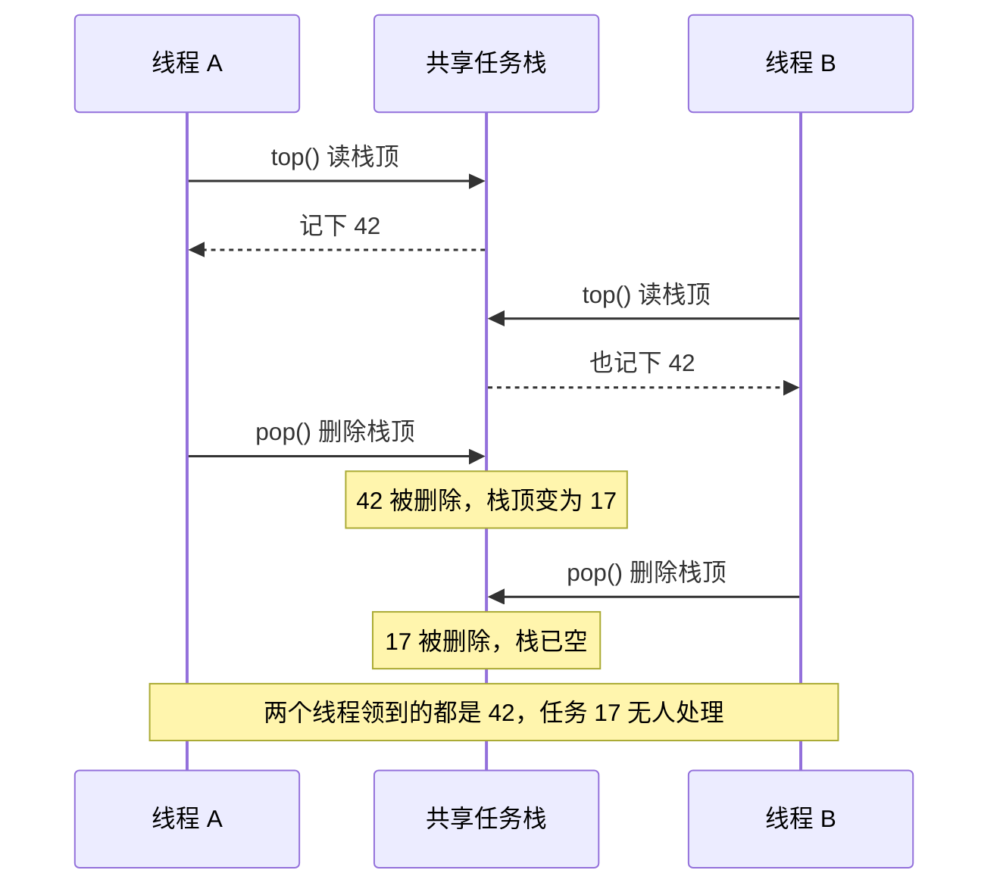

# 📘 17.2 共享数据与互斥同步 (Sharing Data Between Threads)

> 两个线程共用一张表时，查询、插入、删除各需要锁住哪几步？本节从一条双向链表讲起，用线程安全栈、交换两个对象和域名缓存说明锁的用法。

---

## 🧠 核心概念总览

1. [*知识点1: 竞态条件使结果依赖执行顺序，数据竞争导致未定义行为*](#id1)
2. [*知识点2: 读写链表共用一把 mutex，由 lock_guard 自动解锁*](#id2)
3. [*知识点3: 传出内部指针或引用可能让调用者绕过锁*](#id3)
4. [*知识点4: 线程安全栈应把判空、取值和删除合成一次出栈操作*](#id4)
5. [*知识点5: 用 std::lock 一起获取多把锁，避免加锁顺序造成死锁*](#id5)
6. [*知识点6: 用 unique_lock 把独立计算移到锁外，缩短持锁时间*](#id6)
7. [*知识点7: call_once 和局部 static 保护初始化，后续并发修改仍需同步*](#id7)
8. [*知识点8: 读写锁允许并发读取，const 查询写缓存时也要独占*](#id8)
9. [*知识点9: 递归锁允许同一线程重复加锁，定时锁支持限时等待*](#id9)

---

<a id="id1"></a>
## ✅ 知识点1: 竞态条件使结果依赖执行顺序，数据竞争导致未定义行为

**两个线程可以一起遍历只读链表。若一个线程改写节点的指针，另一个线程在没有同步的情况下读取同一指针，就会发生数据竞争。**

**理论**

- 设一段双向链表为 `A ⇄ B ⇄ C`。删除 B 时，要让 A 的后继指向 C，还要让 C 的前驱指回 A。
- 两处指针都改好，这次删除才算完成。如果遍历线程能在中途进来，沿两个方向就可能读到互相矛盾的连接。
- “相邻节点的前后指针能互相对应”，就是这条链表需要维持的**不变量（invariant）**。

**示例/实践**

| 概念 | 从例子理解 |
|---|---|
| **竞态条件（race condition）**：程序的正确性依赖于多个操作的执行顺序或时机 | 两人抢最后一张电影票，谁先买到都合理，结果取决于线程操作的先后，若两人都拿到同一个座位，才是程序需要解决的错误 |
| **数据竞争（data race）**：两个线程访问同一内存位置，至少一方写、至少一次访问是非原子的，且两次访问间没有同步来保证先后。 | 例如两个线程同时对同一个普通 `int` 执行 `count++`，会导致**未定义行为** |

**注意点**

> ⚠️ 数据竞争发生时，不能把结果预测成“最多少加一次”。即使每次读写都加了锁，几步操作之间仍可能出现逻辑错误，见[知识点4](#id4)。

---

<a id="id2"></a>
## ✅ 知识点2: 读写链表共用一把 mutex，由 lock_guard 自动解锁

删除一个链表节点需要改两处指针。怎样让遍历线程等到两处都改好，再继续读？

**让修改和遍历都先取得同一把锁，就能避免查询线程读到指针只改了一半的链表。** 插入节点也一样。若 `add_to_list()` 已经取得锁，`list_contains()` 就会等插入完成再开始查找。

**理论**

- **互斥量（mutex）**： 同一时刻只允许一个线程独占。
- 从取得锁到释放锁，这段访问共享数据的代码称为**临界区（critical section）**。手动调用 `lock()` 和 `unlock()` 容易漏掉异常退出的路径。**锁管理器 `std::lock_guard`** 在构造时加锁，在析构时解锁，这就是 RAII 在这里的用法。

**示例/实践**

```cpp
#include <list>
#include <mutex>
#include <algorithm>

std::list<int> some_list;    // 1
std::mutex some_mutex;       // 2

void add_to_list(int new_value)
{
    std::lock_guard<std::mutex> guard(some_mutex);    // 3
    some_list.push_back(new_value);
}

bool list_contains(int value_to_find)
{
    std::lock_guard<std::mutex> guard(some_mutex);    // 4
    return std::find(some_list.begin(),some_list.end(),value_to_find) != some_list.end();
}
```

两次调用各有自己的局部变量 `guard`，但它们锁住的是**同一个** `some_mutex`。若插入元素时抛出异常，在退出函数、前往外层 `catch` 的过程中，`guard` 也会析构并解锁。

---

<a id="id3"></a>
## ✅ 知识点3: 传出内部指针或引用可能让调用者绕过锁

用同一把锁保护链表，前提是所有线程都通过加锁的函数访问它。如果调用者从函数里拿走了内部元素的地址，再通过这个地址读写时，还会经过那把锁吗？

**链表查询返回一个 `bool`，调用者只能拿走答案。若函数把内部对象的地址也交出去，调用者就能在锁外继续访问原对象。**

**理论**

- 把互斥量和数据都设为类的私有成员，可以让读写操作集中在类里。
- 但如果返回内部对象的指针或引用，或让外部函数保存它，调用者就能绕过类里约定的加锁步骤。

**示例/实践**

书中的 `process_data` 在锁内调用外部提供的函数 `func(data)`。下面这个回调把收到的地址保存在外部变量 `unprotected` 里。

```cpp
void malicious_function(some_data& protected_data)
{
    unprotected=&protected_data;
}
```

等 `process_data` 返回，调用者再执行 `unprotected->do_something()`，操作的仍然是同一份数据，这次却没有持锁。如果调用者只需要查询结果，可以像上一例那样返回一个值，让它在锁外使用自己的结果。

**注意点**

> ⚠️ 如果传出去的是 **`shared_ptr`（共享所有权指针）**，要看两个线程碰到的是哪一层。
>
> - **各自的指针副本**可以分别复制或销毁。引用计数的增减由库协调，对象在最后一位所有者放手前仍会存活。
> - **同一个指针变量**若由一方替换、另一方读取，需要同步。
> - **指向的对象**有自己的读写规则。两份指针指向同一个普通整数时，两边同时修改这个整数也需要同步。

---

<a id="id4"></a>
## ✅ 知识点4: 线程安全栈应把判空、取值和删除合成一次出栈操作

**假设我们已经堵住了绕过锁的办法，每个函数也都加了锁，这个接口就一定安全吗？**

**还不能保证。每个函数都可以安全地完成自己那一步，但如果调用者必须连续调用几个函数才能办完一件事，其他线程仍然可以在两次调用之间改动数据。**

设线程 A 和 B 从同一个栈领任务，每个任务只应被领走一次。栈的每个成员函数都单独加锁，`top()` 也只在锁内复制一份任务编号给调用者。A 拿到的是一个整数，不能通过它改动栈。可 A 读到 `42` 以后，再调用 `pop()`，删掉的还一定是 `42` 吗？

**理论**

- 用这组接口领一次任务，要先用 `empty()` 判空，用 `top()` 保存栈顶编号，再用 `pop()` 删除栈顶。`pop()` 不返回编号，所以要先读再删。
- 栈只剩一个元素时，A 调用 `empty()` 得到“非空”，B 随即把它弹出。
- A 再调用 `top()` 就是在访问空栈，对标准栈来说，这是未定义行为。
- 即使栈里有两个元素，A、B 也可能先后读到同一个栈顶，再各自弹出一个元素。结果一个值被处理两遍，另一个值无人处理。

**两个线程怎么领到了同一个任务？** 假设栈顶是 `42`，下面是 `17`。A 和 B 都已确认栈非空。图中每次读取编号都在锁内完成，调用结束就解锁。图中箭头按时间从上往下排列。



图里 B 读到了 `42`，删掉的却是 `17`。`top()` 返回的副本保留了编号，却没有替 B 把任务留在栈顶。**要让调用者一次领走一个任务，栈就得在同一次持锁期间完成判空、复制编号和删除。**

**示例/实践**

下面的 `pop(T& value)` 就是这个领取接口。`data` 是内部栈，`value` 是调用者用来接收任务编号的变量。

```cpp
void pop(T& value)
{
    std::lock_guard<std::mutex> lock(m);
    if(data.empty()) throw empty_stack();
    value=data.top();
    data.pop();
}
```

从检查到弹出只加一次锁，其他线程只能在这次操作完成后再取。注意最后两行的顺序。如果给 `value` 赋值时抛出异常，`data.pop()` 还没执行，元素仍在栈里。

**注意点**

> 💡 判断容器能否并发访问，要看实际碰到的内存和容器结构。例如，固定大小的 `vector<int>` 不再增删元素，两个线程分别修改不同的已有整数，可以并行。`vector<bool>` 的不同元素可能共用一个机器字，因此写不同下标也可能发生冲突。若一方在增删元素，还要保护容器结构本身。

---

<a id="id5"></a>
## ✅ 知识点5: 用 std::lock 一起获取多把锁，避免加锁顺序造成死锁

从一个栈取任务，一把锁就能保护整件事。如果一次操作涉及两份数据，每份又有自己的锁，怎样才能拿齐两把锁，避免两个线程各拿一把、互相等下去？

**交换两个各自带锁的对象时，可以用 `std::lock` 一起取得两把锁，保护整个交换过程。**

**理论**

如果规定“先锁第一个参数”，A 调用 `swap(x, y)`，B 调用 `swap(y, x)`，就可能出现 A 拿着 `x` 的锁等 `y`，B 拿着 `y` 的锁等 `x`。谁也走不到解锁那一行，这就是**死锁（deadlock）**。如果必须分开取得两把锁，就要给**锁本身**规定顺序，让所有线程都遵守。

**示例/实践**

下面是交换函数的主体。每个对象的 `m` 保护自己的 `some_detail`。

```cpp
if(&lhs==&rhs)
    return;
std::lock(lhs.m,rhs.m);    // 1
std::lock_guard<std::mutex> lock_a(lhs.m,std::adopt_lock);    // 2
std::lock_guard<std::mutex> lock_b(rhs.m,std::adopt_lock);    // 3
swap(lhs.some_detail,rhs.some_detail);
```

第一步排除和自身交换，以免重复锁住同一个普通互斥量。`std::lock` 避免在取得这两把锁的过程中发生死锁。`std::adopt_lock` 表示“当前线程已经取得锁”，两个 `lock_guard` 接手后在退出时各释放一把锁。

**注意点**

> ⚠️ 持锁调用未知的回调，或持锁 `join()` 一个还要来拿这把锁的线程，都可能造成新的循环等待。阅读卡住的代码时，要看线程在等谁。若双方一直重试、互相干扰，工作却没有进展，叫**活锁（livelock）**。若其他线程陆续完成，只有某个线程长期得不到机会，叫**饥饿（starvation）**。

---

<a id="id6"></a>
## ✅ 知识点6: 用 unique_lock 把独立计算移到锁外，缩短持锁时间

交换两个对象时，必须同时持锁到交换完成。可一项工作如果只有一部分会碰到共享数据，还需要让其他线程一直等到整项工作做完吗？

**线程如果已经取走一份可以独立处理的数据，就可以先解锁再计算。** 下面用 `unique_lock` 在取数据和写回结果时持锁，计算期间其他线程可以取走下一份工作。

**理论**

`lock_guard` 适合整段代码都需要锁的情形。**`std::unique_lock`** 还记得自己当前是否持锁，所以能中途 `unlock()`、稍后再 `lock()`，析构时也只释放仍然持有的锁。使用 `std::defer_lock` 可以推迟加锁，使用移动操作可以在同一线程的不同作用域之间交接持锁责任。

**示例/实践**

```cpp
void get_and_process_data()
{
    std::unique_lock<std::mutex> my_lock(the_mutex);
    some_class data_to_process=get_next_data_chunk();
    my_lock.unlock();    // 1 不要让锁住的互斥量越过process()函数的调用
    result_type result=process(data_to_process);
    my_lock.lock();      // 2 为了写入数据，对互斥量再次上锁
    write_result(data_to_process,result);
}
```

这里 `get_next_data_chunk()` 和 `write_result()` 访问共享数据，`process()` 处理的是当前线程拿到的那一份。**锁的粒度（lock granularity）** 指一把锁管多少数据。**持锁时间**取决于哪些操作在锁内执行。这个例子保留同一把锁，只把耗时的计算移到锁外。

**注意点**

> ⚠️ 重新加锁时，其他线程可能已经改过数据。例如分别锁住两个对象，各读出一个数后再比较。即使两个副本相等，也只能说明两次读到了同一个数，无法保证两个对象曾在同一时刻相等。
>
> 🔄 条件变量的 `std::condition_variable::wait` 也需要一个已经持锁的 `std::unique_lock<std::mutex>`。它在等待期间解锁，返回前重新加锁。

---

<a id="id7"></a>
## ✅ 知识点7: call_once 和局部 static 保护初始化，后续并发修改仍需同步

前面把独立计算移到了锁外，但每次领取数据仍要加锁。如果大家争着做的事只需要成功一次，那么事情办成以后，后来的线程还需要排队检查“做过没有”吗？

**打开共享连接就是这样的一次初始化。** 发送线程和接收线程都可能先到，它们可以调用 `call_once` 并共用一个标志，等连接成功打开后再收发。

**理论**

假设两个线程都先检查 `resource_ptr` 是否为空，再决定是否创建资源。若一个线程在锁外读这个指针，另一个线程正在锁内给它赋值，检查本身就发生了数据竞争。可用 **`std::once_flag`** 记录同一次初始化，所有入口都用这个标志调用 **`std::call_once`**。

**示例/实践**

连接对象的 `send_data` 和 `receive_data` 在实际收发前，都先执行下面这行代码。

```cpp
std::call_once(connection_init_flag,&X::open_connection,this); // 2
```

对同一个连接对象，第一个成功的调用打开连接。其他调用正常返回时，连接已经打开。如果打开连接的函数抛出异常，本次调用把异常传给调用者，之后使用同一标志的调用仍可尝试。

如果需求只是“第一次进入函数时创建一个对象”，**函数内的局部静态变量（local static）** 更直接。下面的函数在每次调用时返回同一个实例。

```cpp
my_class& get_my_class_instance()
{
    static my_class instance; // 线程安全的初始化过程
    return instance;
}
```

**注意点**

> ⚠️ 从 C++11 起，并发进入声明处的线程会等动态初始化完成。之后调用者拿到的是同一个 `instance`。如果多个线程还要修改它的数据，这些修改也需要同步。连接“只打开一次”和“多个线程可以同时收发”也是两个不同的保证。

---

<a id="id8"></a>
## ✅ 知识点8: 读写锁允许并发读取，const 查询写缓存时也要独占

一次初始化保证了每个线程用到的对象都已建好。如果以后还有人修改它，读和写仍要协调。那两个只读的线程也得排队，一个读完才轮到另一个吗？

**在域名缓存里，查询现有记录的线程可以共享读锁，添加记录或更新地址的线程则要独占缓存。**

**理论**

**读写锁（reader-writer mutex）** 有共享和独占两种用法。多个线程可以同时持有共享锁。一个线程取得独占锁后，其他读者和写者都要等它解锁。中文版的 DNS 缓存使用 **Boost** 的 `boost::shared_mutex`，两个函数访问同一个缓存和同一个互斥量。

**示例/实践**

| 缓存中的操作 | 函数实际做什么 | 加锁方式 |
|---|---|---|
| `find_entry(domain) const` | 在表中查找记录，返回一份结果 | `boost::shared_lock<boost::shared_mutex>`，允许多个查询同时进行 |
| `update_or_add_entry(...)` | 用 `entries[domain] = dns_details` 写入记录 | `std::lock_guard<boost::shared_mutex>`，更新期间独占缓存 |

`find_entry()` 可以用共享锁，因为它只读现成的表项。如果一个查询还要把现算的答案记下来呢？Meyers 的多项式例子中，`roots() const` 第一次被调用时，要把算出的根写入 `rootVals`，再把 `rootsAreValid` 设为真。这两个成员声明为 `mutable`，所以函数确实可以写它们。两个线程同时首次查询，便可能一起写缓存。书中的做法是用同一把互斥量，保护检查标志、填写结果和复制返回值的全过程。

**注意点**

> 💡 DNS 查询能用共享锁，是因为它确实只读表项。如果某个“查询”还会填写缓存，选锁时就要把这次写入也算进去。

---

<a id="id9"></a>
## ✅ 知识点9: 递归锁允许同一线程重复加锁，定时锁支持限时等待

给域名缓存选读写锁，考虑的是**不同线程能否一起访问**。选锁也要看调用者自身的需求。有时，同一线程会再次申请自己持有的锁。有时，线程只愿意等一小段时间，超时就要去做别的事。

**同一线程需要重复加锁时，可用递归互斥量。希望等待超时后转去做别的事，可用定时互斥量。**

**理论**

| 需求 | 互斥量 | 使用条件 |
|---|---|---|
| 一次只让一个线程进入 | `std::mutex` | 当前线程已经持锁时，再对它调用 `lock()` 是未定义行为 |
| 同一线程可以多次取得同一把锁 | **递归互斥量（recursive mutex）** `std::recursive_mutex` | 锁了三次就要解三次，其他线程才能取得这把锁 |
| 尝试加锁，等到超时可以做别的事 | **定时互斥量（timed mutex）** `std::timed_mutex` | 调用 `try_lock_for` 或 `try_lock_until`，只有返回 `true` 才持有锁。实际返回时间可能比指定时间晚 |
| 同时需要重复加锁和限时等待 | `std::recursive_timed_mutex` | 每次成功取得锁，仍要有一次对应的解锁 |

**示例/实践**

书中举了两个公开成员函数相互调用的例子。外层函数已经取得锁，内层函数又尝试取得同一把普通锁，此时程序就违反了 `std::mutex` 的使用条件。可以把共用逻辑提取成一个私有函数，约定调用前须持锁，再由两个公开函数各自负责加锁。

**注意点**

> 💡 递归锁解决的是**同一线程重复取得同一把锁**。若问题只是调用者不愿一直等，选能限时尝试的互斥量就够了。

---

## 🔑 核心要点总结

1. 先找哪些数据必须一起改好，再决定临界区的范围。链表的前后指针、栈的判空与取值，都是分开操作会出错的例子。
2. 读写双方要遵守同一套加锁规则。把内部引用传出锁外，或让查询函数在没有同步时写缓存，都会使这套规则失效。
3. 同时需要多把锁时，要考虑所有线程的加锁顺序。耗时工作可以放到锁外的前提，是它已经能独立完成。
4. 初始化、引用计数和对象内容分别需要什么保护，要逐一判断。对象已建好、仍活着，只解决了其中一部分问题。

## 📌 考试速记版

| 常见提问 | 回答要点 |
|---|---|
| `lock_guard` 和 `unique_lock` 怎么选？ | 从加锁到退出都要持锁，用前者。需要推迟加锁、中途解锁或移动持锁责任，用后者 |
| `adopt_lock` 和 `defer_lock` 怎么区分？ | 前者接手当前线程已经取得的锁，后者创建管理器、把加锁推迟到以后 |
| 每个成员函数都加锁，接口就线程安全了吗？ | 检查是否向外传出了内部数据，以及调用者是否必须分几次调用才能完成一件事 |
| `call_once` 能保证什么？ | 同一标志最多有一次成功的初始化。对象后续的读写要另外判断 |
| `const` 查询能直接用共享锁吗？ | 要确认它确实只读。第一次查询时写入缓存也算写 |
| `shared_ptr` 的引用计数安全，能推出对象内容也安全吗？ | 引用计数保护共享所有权。对同一对象内容的并发读写，还要看对象自己的同步方式 |

**记忆口诀**：同一数据同一锁，检查取值一起做。

<!-- License for the accompanying book code excerpts by Anthony Williams.
Boost Software License - Version 1.0 - August 17th, 2003

Permission is hereby granted, free of charge, to any person or organization
obtaining a copy of the software and accompanying documentation covered by
this license (the "Software") to use, reproduce, display, distribute,
execute, and transmit the Software, and to prepare derivative works of the
Software, and to permit third-parties to whom the Software is furnished to
do so, all subject to the following:

The copyright notices in the Software and this entire statement, including
the above license grant, this restriction and the following disclaimer,
must be included in all copies of the Software, in whole or in part, and
all derivative works of the Software, unless such copies or derivative
works are solely in the form of machine-executable object code generated by
a source language processor.

THE SOFTWARE IS PROVIDED "AS IS", WITHOUT WARRANTY OF ANY KIND, EXPRESS OR
IMPLIED, INCLUDING BUT NOT LIMITED TO THE WARRANTIES OF MERCHANTABILITY,
FITNESS FOR A PARTICULAR PURPOSE, TITLE AND NON-INFRINGEMENT. IN NO EVENT
SHALL THE COPYRIGHT HOLDERS OR ANYONE DISTRIBUTING THE SOFTWARE BE LIABLE
FOR ANY DAMAGES OR OTHER LIABILITY, WHETHER IN CONTRACT, TORT OR OTHERWISE,
ARISING FROM, OUT OF OR IN CONNECTION WITH THE SOFTWARE OR THE USE OR OTHER
DEALINGS IN THE SOFTWARE.
-->
