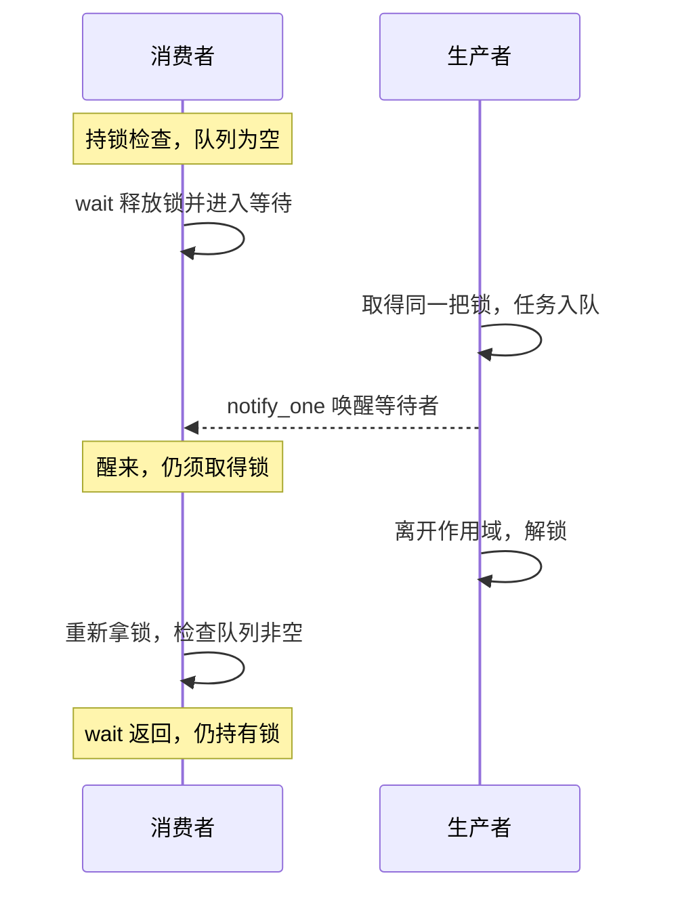

# 📘 17.3 条件变量与线程协作 (Condition Variables and Thread Coordination)

> 一位生产者把任务放进队列，两位消费者从中取任务。本节用这个例子讲清楚，没活时怎么等，有活时叫醒谁，以及最后一项任务处理完后怎样退出。示例使用 C++11。

## 🧠 核心概念总览

1. [*知识点1: 队列为空时，消费者可以睡眠等待任务到来*](#id1)
2. [*知识点2: 队列保存任务，通知提醒消费者检查队列*](#id2)
3. [*知识点3: wait 在睡眠前释放锁，返回前重新拿锁*](#id3)
4. [*知识点4: 通知可能先到，睡前检查队列就不会错过已有任务*](#id4)
5. [*知识点5: 醒来后重新检查条件，再决定是否取任务*](#id5)
6. [*知识点6: wait_and_pop 把等待和出队合起来，任务在锁外处理*](#id6)
7. [*知识点7: 一项任务可唤醒一个消费者，所有人都要响应时再广播*](#id7)
8. [*知识点8: 限时等待要守住同一个截止时刻*](#id8)
9. [*知识点9: 关闭队列时叫醒所有消费者，取完剩余任务再退出*](#id9)

---

<a id="id1"></a>
## ✅ 知识点1: 队列为空时，消费者可以睡眠等待任务到来

17.2 用同一把锁保护取任务的过程，保证一个任务只被领走一次。可消费者拿到锁，发现队列是空的，该怎么办？如果它拿着锁等，生产者连队列都改不了。如果它放开锁，怎样知道什么时候该再来看一眼？

**理论**

- 假设生产者负责把任务放进队列，消费者负责取任务，队列现在是空的，消费者怎么知道下一个任务到了？
    - 持锁反复检查空队列，生产者就拿不到这把锁来入队。每次都解锁再来检查，生产者有机会入队，但消费者仍要反复抢锁、检查。
    - 还可以每隔一段时间检查一次，这叫**轮询（polling）**。间隔短了会频繁空查，间隔长了又会耽误已经到达的任务。
- **条件变量（condition variable）让消费者在没有任务时睡眠等待，生产者放入任务后再叫醒它。**

**示例/实践**

假设消费者每隔 100 毫秒检查一次，任务恰好在它刚睡下后到达。队列里明明有活，它仍要等这次休眠结束才会发现。用 C++11 的 `std::condition_variable`（头文件 `<condition_variable>`），就可以在任务入队时通知等待者。

**注意点**

> 💡 互斥量解决的是“现在谁能访问队列”，条件变量解决的是“现在没有活，怎样等到值得再看一眼的时候”。

---

<a id="id2"></a>
## ✅ 知识点2: 队列保存任务，通知提醒消费者检查队列

消费者可以等人叫醒了。可是被叫醒时，它凭什么知道自己能够取出任务？看队列里有没有数据，还是只看刚才有没有人发通知？

**理论**

**是否可以出队，由锁保护下的共享状态决定。通知的作用是让正在等待的线程醒来检查这个状态。**

**示例/实践**

沿用一位生产者、两位消费者的例子。`produced_nums` 存放待处理的整数，`mtx` 同时保护队列和布尔变量 `notified`。生产者已经持有 `mtx`，接着执行：

```cpp
produced_nums.push(i);
notified = true;
cv.notify_all(); // 此处也可以使用 notify_one
```

第一行把数据存入队列。第二行把“有一批数据要检查”记在共享变量里，消费者处理完这一批会把它设回 `false`。第三行叫醒正在 `cv` 上等待的消费者。即使生产者连续放入三个数，布尔值也只能表示“有”，具体是哪三个数要看队列。

如果消费者只关心“队列里有没有任务”，可以直接检查 `!queue.empty()`，省掉额外的标志。这个返回真或假的检查叫**谓词（predicate）**，也就是线程继续执行需要满足的条件。

**注意点**

> ⚠️ 生产者在锁内改变队列或标志，消费者用**同一把互斥量**检查它。因此这里的 `notified` 可以是普通 `bool`。发一次通知不会替这些读写加锁。

---

<a id="id3"></a>
## ✅ 知识点3: wait 在睡眠前释放锁，返回前重新拿锁

消费者必须拿锁才能检查队列，但要让生产者放入任务，又必须把锁交出去。如果消费者自己先解锁、稍后才开始等，生产者恰好在两步之间发出通知怎么办？

**理论**

**`wait` 把“释放互斥量”和“进入等待”作为不可分割的一步。醒来后，它先重新取得这把锁，调用者才能继续访问队列。**

**示例/实践**

这里 `data_cond` 是条件变量，`mut` 保护队列 `data_queue`。消费者这样等待：

```cpp
std::unique_lock<std::mutex> lk(mut);  // 4
data_cond.wait(
    lk,[]{return !data_queue.empty();});  // 5
```

1. 消费者先持有 `mut`。如果队列已有任务，谓词立即返回 `true`，消费者直接往下执行。
2. 如果队列为空，`wait` 释放 `mut` 并进入等待。此时生产者才能取得 `mut`、入队并通知。
3. 消费者被唤醒后，再次取得 `mut`，重新检查谓词。条件为真才从上述调用返回，而且**返回时仍持有锁**。条件为假就再等。



**注意点**

> 📋 `std::condition_variable::wait` 接受已持锁的 `std::unique_lock<std::mutex>`，因为等待期间需要解锁、再上锁。`lock_guard` 不提供这两个操作。如果使用的是另一种满足 `lock()`、`unlock()` 要求的锁，可以选 `std::condition_variable_any`。

---

<a id="id4"></a>
## ✅ 知识点4: 通知可能先到，睡前检查队列就不会错过已有任务

`wait` 解决了消费者从检查转入等待时的空隙。换个先后顺序：生产者已经入队并发完通知，消费者才启动。那次通知还有谁能收到？队列里的任务会不会就此没人取？

**理论**

**没有等待者时，条件变量不会替后来者保存通知。消费者先检查队列，即使错过了通知，也能发现仍在队列里的任务。**

**示例/实践**

| 先后 | 生产者 | 消费者 |
|---|---|---|
| ① | 持锁放入任务 42，发出通知并解锁 | 还没有启动 |
| ② | | 取得同一把锁，调用带谓词的 `wait` |
| ③ | | 检查到队列非空，直接取走 42，整个过程都不需要睡眠 |

如果第 ② 步改成无条件调用 `cv.wait(lock)`，消费者就可能在已有任务的情况下睡下去，直到再有通知或发生虚假唤醒。使用 `notified` 的写法之所以也能处理通知先到，是因为生产者把标志设成了 `true`。只要它仍为真，后来者检查时就能看到。

**注意点**

> 💡 若另一个消费者已经取走了 42，此时队列确实为空，后来者继续等是正确行为。判断依据始终是**拿到锁时还有没有任务**。

---

<a id="id5"></a>
## ✅ 知识点5: 醒来后重新检查条件，再决定是否取任务

睡前检查解决了“通知来得太早”的问题。现在消费者确实睡下了，也确实醒了，为什么还不能直接执行 `front()`？

**理论**

**醒来只是一次重新检查的机会。消费者重新拿锁后，只有条件仍然成立，才能继续。**

**示例/实践**

在带 `notified` 标志的例子里，消费者这样等待：

```cpp
while (!notified) {  // 避免虚假唤醒
    cv.wait(lock);
}
```

循环照顾了两种情况：

- **虚假唤醒（spurious wakeup）**。即使没有线程调用通知，等待也可能醒来。如果生产者还没入队，`notified` 仍为 `false`，循环会再次等待。注释中的“避免”指避免醒来后误往下执行；循环本身不能阻止唤醒发生。
- **确实收到了通知，条件又变了。** 如果两位消费者都在等一个任务，生产者广播后，A 先拿锁取走了任务，B 后拿锁时队列已经空了。B 收到的通知是真的，只是任务已经被 A 领走。

对直接看队列的版本，`cv.wait(lock, pred)` 就相当于 `while (!pred()) cv.wait(lock);`，每次都在锁内检查。若用单次 `if` 包住不带谓词的 `wait`，醒来后就跳过了这次复查。

**注意点**

> ⚠️ 带谓词的 `wait` 返回时，条件是在锁内确认的。如果主动解锁，稍后重新加锁，先前的判断可能已经过期。原来的双消费者例子在模拟耗时前解锁，回来后又用 `while (!produced_nums.empty())` 检查队列，才去取元素。

---

<a id="id6"></a>
## ✅ 知识点6: wait_and_pop 把等待和出队合起来，任务在锁外处理

既然消费者醒来还要检查队列，能不能检查完就先解锁，再单独调用取值函数？17.2 的栈已经展示过，中间一旦放开锁，另一个线程就可能把最后一个元素取走。

**理论**

**把等待、确认非空、取走队首合成一个接口 `wait_and_pop`。任务一旦取到自己的变量里，就可以解锁去处理。**

**示例/实践**

把队列及其同步操作放进同一个类以后，生产者和消费者只需调用下面两个成员函数。这里 `data_queue`、`mut` 和 `data_cond` 分别对应前例的队列、互斥量和条件变量。

```cpp
void push(T new_value)
{
    std::lock_guard<std::mutex> lk(mut);
    data_queue.push(new_value);
    data_cond.notify_one();
}

void wait_and_pop(T& value)
{
    std::unique_lock<std::mutex> lk(mut);
    data_cond.wait(lk,[this]{return !data_queue.empty();});
    value=data_queue.front();
    data_queue.pop();
}
```

生产者调用 `push` 交付任务。消费者调用 `wait_and_pop(data)`，返回时 `data` 已经装着取出的任务，局部锁 `lk` 也已析构。消费者随后执行 `process(data)` 时，另一位消费者可以进入队列取得下一项独立任务。

带 `notified` 的原例选择**一次取完队列里的一批数**。这里的接口改为**每次取一项**，所以唤醒一位消费者就可能足够。若业务要求“没有任务就立即返回”，可以另外提供 `try_pop`，保持判空和取值仍在一次持锁期间完成。

**注意点**

> 💡 队列的锁保护的是“谁领走哪一项”。取出的任务能否并行处理，还要看它们是否会修改其他共享数据。

---

<a id="id7"></a>
## ✅ 知识点7: 一项任务可唤醒一个消费者，所有人都要响应时再广播

同一个队列可以供两个消费者取任务，那每次入队要叫醒几个人？是只要有一个人能干活，还是这次状态变化需要每一个等待者都知道？

**理论**

**`notify_one()` 唤醒一个正在等待的线程，`notify_all()` 唤醒当前所有等待者。按这次变化能让谁继续工作来选。**

**示例/实践**

| 共享状态发生的变化 | 合适的通知 | 被唤醒之后 |
|---|---|---|
| 加入一项任务，两位消费者做同一种工作 | `notify_one()` | 一位等待者醒来竞争锁，拿到锁后检查队列并尝试取任务 |
| 状态改变，每位等待者都需要响应 | `notify_all()` | 所有人都有机会重新检查自己的等待条件 |
| 只加一项任务，却叫醒所有消费者 | 广播也能工作 | 即使全醒，也只有一个人能领到这项任务，其余人可能拿锁检查后又睡回去 |

前面的 `push` 在持锁时通知，消费者醒来仍要等生产者解锁。也可以**先在锁内更新状态，解锁后再通知**，前提是通知发生时条件变量仍然存活。两种写法里，生产者修改状态与消费者检查状态都由同一把互斥量保护。

**注意点**

> ⚠️ `notify_one()` 不让调用者指定醒来的是哪一个线程。如果当时无人等待，任务仍留在队列中，按[知识点4](#id4)的方式在下次取任务时检查即可。

---

<a id="id8"></a>
## ✅ 知识点8: 限时等待要守住同一个截止时刻

已经选好了唤醒谁，可如果一直没有新任务，消费者最多只愿等 500 毫秒怎么办？尤其是在第 490 毫秒醒来、检查后仍然没有任务时，它还应该再等整整 500 毫秒吗？

**理论**

**限制总等待时间，就在开始时算好截止时刻，每次醒来都沿用它。** `wait_for` 接受一段时长，`wait_until` 接受一个时间点。

**示例/实践**

下面等待共享标志 `done`。它与前面的“队列非空”作用相同，都是线程在互斥量保护下检查的条件。这里 `m` 保护 `done`，`cv` 用来通知状态变化。

```cpp
bool wait_loop()
{
    auto const timeout= std::chrono::steady_clock::now()+
        std::chrono::milliseconds(500);
    std::unique_lock<std::mutex> lk(m);
    while(!done)
    {
        if(cv.wait_until(lk,timeout)==std::cv_status::timeout)
            break;
    }
    return done;
}
```

如果在自己的循环里反复调用 `cv.wait_for(lk, std::chrono::milliseconds(500))`，每次都会重新开始一段 500 毫秒的等待。上例用 `steady_clock` 只算一次截止时刻，第 490 毫秒复查后就只剩约 10 毫秒。也可以只调用一次带谓词的 `cv.wait_for(lk, std::chrono::milliseconds(500), pred)`，由它在同一段时限内复查，返回值表示最终检查时条件是否成立。

**注意点**

> ⚠️ 不带谓词的等待返回 `no_timeout`，仍需检查条件。`return done;` 回答的是“拿着锁检查时，事情完成了吗”。截止时刻到了，线程还要重新拿到锁才能返回，因此实际返回时间可能更晚。

---

<a id="id9"></a>
## ✅ 知识点9: 关闭队列时叫醒所有消费者，取完剩余任务再退出

等了 500 毫秒还没有任务，只能说明这段时间没等到。消费者怎样知道“生产者以后都不会再放任务了”，从而可以放心退出？

**理论**

**给队列增加一个受同一把锁保护的 `closed` 标志。消费者等“有任务或队列已关闭”，只在“已关闭且队列为空”时退出。** 这里选择的是处理完已有任务再退出。

**示例/实践（在双消费者例子上扩展）**

仍用一个生产者和两个消费者，约定生产者放完最后一项才调用 `close_queue()`，此后不再入队。这里用队列是否为空代替 `notified`，并增加初值为 `false` 的 `closed`。下面两段函数共用 `mtx`、`cv` 和整数队列 `produced_nums`。

```cpp
bool closed = false;

void close_queue() {
    {
        std::lock_guard<std::mutex> lock(mtx);
        closed = true;
    }
    cv.notify_all();
}

bool wait_and_pop(int& value) {
    std::unique_lock<std::mutex> lock(mtx);
    cv.wait(lock, [] { return closed || !produced_nums.empty(); });
    if (produced_nums.empty()) return false;
    value = produced_nums.front();
    produced_nums.pop();
    return true;
}
```

- **还有任务**：即便已经关闭，`wait_and_pop` 仍取出一项，返回 `true`。消费者在锁外处理它，再来取下一项。
- **已关闭且队列为空**：函数返回 `false`，消费者结束循环。后来才来取任务的线程也能看到 `closed`，不会错过退出。
- **尚未关闭且队列为空**：谓词为假，消费者继续等待。关闭时用 `notify_all()`，所有可能睡着的消费者都有机会看见结束条件。

消费者的循环现在可以写成下面这样。`false` 表示可以退出，而 `true` 表示已经领到一项任务。

```cpp
int value;
while (wait_and_pop(value)) {
    process(value);
}
```

原来的生产和消费循环都没有主动退出的条件。书中的另一种写法是在消费者处理到最后一个数据块时 `break`。这里要让两位消费者分别退出，所以用双方都能检查的 `closed` 配合广播。队列关闭后，主线程用 `join()` 等生产者和两个消费者结束，再销毁队列、互斥量和条件变量。

**注意点**

> ⚠️ 主线程等待消费者 `join()` 时应已释放 `mtx`。被唤醒的消费者还需要这把锁，才能检查关闭状态并退出。

---

## 🔑 核心要点总结

1. 生产者在锁内改变共享状态，消费者在同一把锁内检查状态。即使通知先到，只要任务仍在队列里，后来者就能取到。
2. 条件不满足时，`wait` 释放锁并进入等待。醒来后先拿锁、再复查。`wait(lock, pred)` 在条件为真时才正常返回，带超时的版本还要区分超时结果。
3. 等待与取任务可以封装成一次调用。拿走任务后再解锁处理，多个消费者就有机会同时工作。
4. 有时限就固定截止时刻，有关闭要求就把关闭状态写进谓词。两者分别回答“等多久”和“还会不会再有任务”。

## 📌 考试速记版

| 常见提问 | 快速判断 |
|---|---|
| `wait` 期间谁持有互斥量？ | 等待的消费者已释放它，生产者可以取得它来入队。消费者返回前要重新取得它 |
| 生产者先通知会怎样？ | 通知不会保存，任务或状态可以保存。先在锁内检查谓词 |
| 真的收到了通知，还要再查吗？ | 要。重新拿到锁前，别的消费者可能已经把任务取走 |
| 两个消费者一定要用 `notify_all()` 吗？ | 看有几个线程需要响应。一项任务可唤醒一个能处理它的等待者，关闭则要让所有等待者有机会退出 |
| 反复醒来，怎样避免延长总等待？ | 用同一个截止时刻，返回后仍在锁内确认条件 |
| 关闭之后还有任务怎么办？ | 本例先处理剩余任务，待已关闭且队列为空时退出 |

**记忆口诀**：睡前看条件，睡时放开锁，醒来再检查，取完再干活。

<!-- License for the accompanying book code excerpts by Anthony Williams.
Boost Software License - Version 1.0 - August 17th, 2003

Permission is hereby granted, free of charge, to any person or organization
obtaining a copy of the software and accompanying documentation covered by
this license (the "Software") to use, reproduce, display, distribute,
execute, and transmit the Software, and to prepare derivative works of the
Software, and to permit third-parties to whom the Software is furnished to
do so, all subject to the following:

The copyright notices in the Software and this entire statement, including
the above license grant, this restriction and the following disclaimer,
must be included in all copies of the Software, in whole or in part, and
all derivative works of the Software, unless such copies or derivative
works are solely in the form of machine-executable object code generated by
a source language processor.

THE SOFTWARE IS PROVIDED "AS IS", WITHOUT WARRANTY OF ANY KIND, EXPRESS OR
IMPLIED, INCLUDING BUT NOT LIMITED TO THE WARRANTIES OF MERCHANTABILITY,
FITNESS FOR A PARTICULAR PURPOSE, TITLE AND NON-INFRINGEMENT. IN NO EVENT
SHALL THE COPYRIGHT HOLDERS OR ANYONE DISTRIBUTING THE SOFTWARE BE LIABLE
FOR ANY DAMAGES OR OTHER LIABILITY, WHETHER IN CONTRACT, TORT OR OTHERWISE,
ARISING FROM, OUT OF OR IN CONNECTION WITH THE SOFTWARE OR THE USE OR OTHER
DEALINGS IN THE SOFTWARE.
-->
