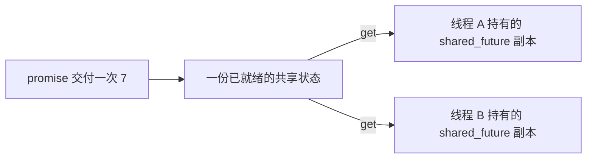

# 📘 17.4 异步任务与结果传递 (Asynchronous Tasks and Futures)

> 主线程把工作交出去，继续做别的事，需要答案时再来取。本节用 C++11 的 `<future>` 讲清三个问题：谁执行任务，谁交付值或异常，谁在等什么。

## 🧠 核心概念总览

1. [*知识点1: 用 future 接收一次任务的结果*](#id1)
2. [*知识点2: async 提交函数，执行策略决定函数何时运行*](#id2)
3. [*知识点3: wait 等就绪，get 取结果，限时等待还要识别延迟任务*](#id3)
4. [*知识点4: packaged_task 打包函数和结果，由调用它的线程执行任务*](#id4)
5. [*知识点5: promise 让产生结果的一方决定何时交付*](#id5)
6. [*知识点6: 计算失败也能交付，调用者在 get 处收到异常*](#id6)
7. [*知识点7: 多个线程读取同一结果时，各持一份 shared_future 副本*](#id7)
8. [*知识点8: 最后一个 future 析构时，可能要等 async 启动的线程结束*](#id8)
9. [*知识点9: 只需通知一次完成时，用 `promise<void>` 和 `future<void>`*](#id9)

---

<a id="id1"></a>
## ✅ 知识点1: 用 future 接收一次任务的结果

17.3 里，生产者把任务放进队列，消费者醒来取走任务。现在消费者算完了，主线程还想拿到那个数。`join()` 可以等线程结束，条件变量可以通知主线程来检查状态。那这个数放在哪里？如果计算失败，主线程又从哪里知道？

**理论**

- **一次任务的值或异常可以存入共享状态（shared state），调用者先拿到关联它的 `std::future<T>`，需要结果时再调用 `get()`。** 
- 例如 `future<int>` 表示将来要取一个整数。任务还在算时，主线程可以先做其他工作。等到 `get()` 需要这个数时，如果结果还没准备好，就得等。


**示例/实践**

下面的计算函数返回一个整数。主线程提交计算、做自己的事，最后才打印答案。

```cpp
#include <future>
#include <iostream>

int find_the_answer_to_ltuae();
void do_other_stuff();
int main()
{
    std::future<int> the_answer=std::async(find_the_answer_to_ltuae);
    do_other_stuff();
    std::cout<<"The answer is "<<the_answer.get()<<std::endl;
}
```

第一行拿到 `the_answer` 时，主线程已经有了日后取结果的途径。它可以先做 `do_other_stuff()`，直到打印答案这一行才需要那个整数。计算有没有和这段工作同时进行，取决于提交时的执行策略。

**`std::future` vs `std::optional` 区别**
- `std::optional<Value>`：查询已经结束，找到就返回 `Value`，没找到就返回 `std::nullopt`。
- `std::future<Value>`：调用者先拿到一个 `future`。调用 `.get()` 时，如果结果还没准备好就等待，准备好后取出值；如果任务抛了异常，`.get()` 会把异常抛出来

**注意点**

> 📋 旧笔记把 `future` 译作“期物”，中文版书中也称“期望”。阅读代码时，可以直接把它理解成“我稍后凭它取得这一次结果”。

---

<a id="id2"></a>
## ✅ 知识点2: async 提交函数，执行策略决定函数何时运行

主线程已经拿到了 `future`。这是否说明计算已经在另一条线程上运行？如果主线程一直忙自己的事，从未索取结果，那个函数还会执行吗？

**理论**

**`std::async` 同时提交函数并返回它的 `future`。执行策略（launch policy）决定谁来运行这个函数。**

| 提交方式 | 函数在哪里、何时执行 |
|---|---|
| `std::launch::async` | 成功提交后，函数在另一条线程上执行，调用者可与它并发工作 |
| `std::launch::deferred` | 提交时只把函数和参数存起来。之后，哪个线程先调用这个 `future` 的 `wait()` 或 `get()`，哪个线程就亲自运行这个函数。 |
| 省略策略 | 允许库在上述两种方式中选择。调用者若要求在另一条线程上执行，就显式指定 `std::launch::async` |

**示例/实践**

沿用上一例，只把策略指定为延迟执行。

```cpp
auto answer = std::async(std::launch::deferred, find_the_answer_to_ltuae);
do_other_stuff();
int value = answer.get();
```

这次可以判断先后顺序：主线程先做完 `do_other_stuff()`，到 `get()` 这一行才亲自执行计算。如果这份延迟任务从未被触发，最后一个关联句柄也被销毁，函数就不会执行。

**注意点**

> ⚠️ `async` 是接口名。看见它就断言“程序一定新开了一条线程”，会误判默认策略和 `deferred` 的行为。

---

<a id="id3"></a>
## ✅ 知识点3: wait 等就绪，get 取结果，限时等待还要识别延迟任务

延迟任务可以由 `wait()` 或 `get()` 启动，那为什么有的代码先 `wait()` 再 `get()`，有的却直接 `get()`？如果主线程现在只愿意等一小会儿，又该用什么？

**理论**

**愿意等到就绪、暂时不取值时，用 `wait()`。现在就要取结果，直接用 `get()`。** 对同一个有效的 `std::future<int>`，区别如下。

| 操作 | 回答的问题 | 调用后的结果 |
|---|---|---|
| `valid()` | 这个句柄还关联共享状态吗？ | 不等待。返回 `true` 时，任务仍可能没做完 |
| `wait()` | 这次结果准备好了吗？ | 等到就绪，保留取值机会。状态里也可能存着异常 |
| `get()` | 这次结果到底是什么？ | 等到就绪后返回整数或重新抛出已存的异常。这份普通 `future` 的取值机会随之用掉，不能再取第二次 |
| `wait_for(d)` / `wait_until(t)` | 等一段时长 / 等到某个时刻，现在是什么状态？ | 返回等待状态，不取走结果，也不会启动尚未执行的延迟任务 |

**示例/实践**

下面检查 35 毫秒内能否拿到结果。只有在检查到结果已就绪的分支里，才调用 `get()`。

```cpp
std::future<int> f=std::async(some_task);
if(f.wait_for(std::chrono::milliseconds(35))==std::future_status::ready)
    do_something_with(f.get());
```

- **`ready`（就绪）**：可以取结果。若里面存着异常，取值时会抛出。
- **`timeout`（超时）**：这次等待到期。任务可以继续执行，调用者稍后仍可等待或取值。
- **`deferred`（延迟）**：这项延迟任务还没有启动。如果循环只检查“是不是 `ready`”，它可能始终等不到。要运行它，可以调用 `wait()` 或 `get()`。

**注意点**

> 💡 旧稿把 `result.wait()` 称为“屏障”。在这个例子里，是主线程在这行等结果就绪，交付结果的线程还可以继续做别的事。若下一行马上要用结果，可以直接 `get()`。若要等指定线程结束，则用 `join()`。

---

<a id="id4"></a>
## ✅ 知识点4: packaged_task 打包函数和结果，由调用它的线程执行任务

`async` 能替调用者安排函数执行。可 17.3 的队列已经有工作线程在取任务，如果我们希望**由那条现成的线程执行函数**，提交者还能提前拿到 `future` 吗？

**理论**

**`std::packaged_task` 把一个可调用对象和它的共享状态放在一起。打包时可以取出 `future`，以后哪个线程调用这个任务，函数就在哪个线程里执行。** `std::packaged_task<int()>` 中的 `int()` 表示函数无需参数，返回一个整数。

**示例/实践**

沿用返回 `7` 的例子。先看清哪一行建立结果的联系，再找哪一行开始执行任务。

```cpp
#include <iostream>
#include <future>
#include <thread>

int main() {
    // 将一个返回值为7的 lambda 表达式封装到 task 中
    // std::packaged_task 的模板参数为要封装函数的类型
    std::packaged_task<int()> task([](){return 7;});
    // 获得 task 的期物
    std::future<int> result = task.get_future(); // 在一个线程中执行 task
    std::thread(std::move(task)).detach();
    std::cout << "waiting...";
    result.wait(); // 在此设置屏障，阻塞到期物的完成
    // 输出执行结果
    std::cout << "done!" << std:: endl << "future result is "
              << result.get() << std::endl;
    return 0;
}
```

1. 构造 `task` 时保存 lambda。执行 `task.get_future()` 时，主线程取得接收端，lambda 还没有被这行代码调用。
2. `std::thread(std::move(task))` 才启动线程。任务可移动、不可复制，因此这里移动它。新线程调用任务，lambda 返回的 `7` 自动存入共享状态。
3. `detach()` 解除线程对象与执行线程的关联。主线程仍然持有 `result`，所以能等到结果并输出 `7`。

如果换成已有的工作线程，提交者可以在取到 `future` 后把任务移动进队列。工作线程取出它、释放队列锁，再调用 `task()`。书中的图形界面线程就是这样接收需要在那个线程上执行的操作。

**注意点**

> ⚠️ 只构造或移交 `packaged_task` 不会执行函数。若主线程把任务留在自己手里，直接 `wait()`，同时也没有别人能调用任务，它就会一直等。使用 `std::move` 的代码可显式包含 `<utility>`。

---

<a id="id5"></a>
## ✅ 知识点5: promise 让产生结果的一方决定何时交付

打包函数时，函数的返回值自然就成了结果。可如果结果要等一份网络回包才能知道，哪个函数的 `return` 能代表这个请求？接包线程怎样把数据交给正在等它的那个人？

**理论**

**`std::promise<T>` 是交付端。请求发出时先用 `get_future()` 把接收端交给调用者，回包到达时再用 `set_value(value)` 填入结果。** 两端关联同一份共享状态。交付后状态就绪，等待者可以继续，而接包线程可以接着处理其他连接。

**示例/实践**

连接上有数据可读时，先读出包，再按请求编号 `data.id` 找到对应的 `promise`。下面是接收分支的节选：

```cpp
data_packet data=connection->incoming();
std::promise<payload_type>& p=
    connection->get_promise(data.id);  // 4
p.set_value(data.payload);
```

`get_promise(data.id)` 是这个连接类自己提供的查找函数。假设请求 A、B 分别在等自己的回复，即使 B 的包先到，接包线程也会填写 B 的那份状态，A 继续等自己的回复。

| 结果从哪里来 | 谁决定何时执行或交付 | 调用者怎样取 |
|---|---|---|
| `async` 提交的函数 | 执行策略决定函数的执行方式，函数返回后自动交付 | 从 `async` 返回的 `future` 取 |
| `packaged_task` 打包的函数 | 程序安排谁调用任务，函数返回后自动交付 | 提前用 `task.get_future()` 取得接收端 |
| `promise` 交付的值 | 掌握结果的代码决定何时调用 `set_value()` | 提前用 `p.get_future()` 取得接收端 |

**注意点**

> ⚠️ 同一个 `promise` 的 `get_future()` 只能成功一次，同一份状态也只能成功交付一次。重复取接收端、重复交付是两种不同的错误。后续还有其他请求时，应为各次结果安排各自的状态。

---

<a id="id6"></a>
## ✅ 知识点6: 计算失败也能交付，调用者在 get 处收到异常

刚才的连接例子假设一定会收到正确的回包。如果请求失败，或者计算函数在返回之前抛出了异常，调用者还在等一个值。怎样让它知道这次已经结束，而且能看到具体错误？

**理论**

**共享状态可以保存一个值，也可以保存一个异常。两种情况都算就绪。** 调用者等到的是“这次已经有结果了”，至于成功还是失败，由 `get()` 告诉它。

**示例/实践**

假设 `square_root` 遇到负数会抛出 `std::out_of_range`。下面两行里，调用者会在哪一行收到这个函数抛出的异常？

```cpp
std::future<double> f=std::async(square_root,-1);
double y=f.get();
```

是第二行。任务函数抛出的异常由 `async` 保存，调用者可在 `f.get()` 外用 `try/catch` 处理。对于 `packaged_task`，调用任务时，包装器也会自动保存被包装函数抛出的异常。换成手动交付的 `promise`，则要由负责计算的一方捕获异常并填入状态：

```cpp
extern std::promise<double> some_promise;
try
{
    some_promise.set_value(calculate_value());
}
catch(...)
{
    some_promise.set_exception(std::current_exception());
}
```

`std::current_exception()` 取出当前正在处理的异常。接收方的 `get()` 会重新抛出它。单独调用 `wait()` 可以等到异常已经存好，但不会替调用者取出并抛出这份异常。

**注意点**

> ⚠️ 如果还没交付值或异常，负责交付的 `promise` 就被销毁，关联状态会就绪，并记录错误 `broken_promise`。接收方的 `get()` 抛出带这个错误码的 `std::future_error`。同样的问题也可能发生在尚未调用的 `packaged_task` 被销毁时。

---

<a id="id7"></a>
## ✅ 知识点7: 多个线程读取同一结果时，各持一份 shared_future 副本

现在，一个调用者可以在 `get()` 处收到结果或异常。但普通 `future` 只有一次取值机会。如果计算只做一遍，两个线程却都需要同一个答案，该把什么交给它们？

**理论**

**用 `share()` 把接收权交给可复制的 `std::shared_future<T>`，再让每个线程持有一份副本。** 副本关联同一份共享状态，哪位读者先取都不消耗其他读者的机会。

**示例/实践**

```cpp
std::promise<int> result;
auto only_reader = result.get_future();
auto reader_a = only_reader.share();
auto reader_b = reader_a;

result.set_value(7);
int a = reader_a.get();
int b = reader_b.get();
```

`share()` 后，`only_reader.valid()` 为 `false`。上例把两位读者的调用写在一起。实际放到两个线程中时，可以把 `reader_a`、`reader_b` 分别按值交给各自的线程。它们读到的都是 `7`，同一个副本也可以再次调用 `get()`。



**注意点**

> 📋 对普通值类型 `T`，`shared_future<T>::get()` 返回共享状态中结果的 `const T&`。上例用 `int` 接收，各自复制了一份整数。若要保留返回的引用，就要保证共享状态在使用期间仍然存活。若结果里有指向可变数据的指针，并发修改那些数据仍需要同步。

---

<a id="id8"></a>
## ✅ 知识点8: 最后一个 future 析构时，可能要等 async 启动的线程结束

一份结果可以有多个读者，某个读者也可能中途放弃，既不 `wait()` 也不 `get()`。当最后一个读者离开作用域时，正在做的工作会继续跑，还是会让这个读者等到它结束？

**理论**

**看这份共享状态从哪里来、函数实际怎样执行，以及现在释放的是不是最后一份关联句柄。** 以下三个条件同时成立，才有这里讨论的特殊等待行为：

1. 共享状态由 **`std::async`** 创建。
2. 任务实际采用 **`std::launch::async`**。显式指定这种策略，或由默认策略选中它，都算。
3. 正在析构的对象是**最后一个仍关联这份状态的 future 句柄**。如果还有别的 `shared_future` 副本，就还没到这一步。

此时若关联线程还没结束，释放最后一个句柄可能阻塞，直到它结束。若线程已经结束，就没有剩余工作可等。

**示例/实践**

```cpp
{
    auto last = std::async(std::launch::async, write_report);
    update_status();
} // last 在这里析构
show_finished();
```

假设 `update_status()` 先做完，`write_report()` 还在运行。这里没有其他句柄，走到右大括号时要等写报告的线程结束，才会往下调用 `show_finished()`。如果把任务换成 `deferred`，而代码从未触发它，离开作用域时也不会为了析构而执行 `write_report()`。

**注意点**

> 🔄 回看[知识点4](#id4)：那里的 `result` 从 `packaged_task` 取得，执行线程由程序自己创建。销毁这个 `future` 不会帮你等待那条线程结束。`promise` 交出的 `future` 也没有上述 `async` 析构等待规则。

---

<a id="id9"></a>
## ✅ 知识点9: 只需通知一次完成时，用 `promise<void>` 和 `future<void>`

如果调用者确实需要等某件事完成，就应该能明确写出自己在等什么。假设工作线程初始化好配置就可以发信号，使用方既不需要接收一个数，也不必等工作线程退出。这个一次性信号该怎样交付？

**理论**

**用 `std::promise<void>` 和 `std::future<void>` 共用一份状态。** 初始化方调用无参数的 `set_value()` 表示完成。使用方调用 `get()`，在成功时继续运行，如果存的是异常则收到异常。即使信号先发，状态也会保持就绪，后来者照样能看到。

**示例/实践**

下面让工作线程先写好端口号，再发出“配置可用”的信号。端口号存在 `port` 里，因此信号本身可以用 `void`。

```cpp
int port = 0;
std::promise<void> initialized;
auto ready = initialized.get_future();

std::thread worker([&] {
    port = 8080;
    initialized.set_value();
});
ready.get();
std::cout << port << '\n';
worker.join();
```

工作线程在交付信号前写入 `port`，主线程在成功的 `get()` 返回后才读取，这一次交付建立了两者间的同步关系。末尾的 `join()` 则负责等线程结束。如果两个线程都要使用这份配置，可以事先对接收端调用 `share()`，分别传给它们一份 `shared_future<void>`。

**注意点**

> 💡 “配置已经初始化”只需从未完成变成完成一次。`future<void>` 很适合这种通知。17.3 中的队列却可能反复经历“空、非空、再变空”，每次获取任务都要检查当时的队列，用条件变量配合共享状态更贴切。

---

## 🔑 核心要点总结

1. 提交任务、执行函数、接收结果是三件事。`async` 安排执行，`packaged_task` 让程序决定谁来执行，`promise` 让掌握结果的代码决定何时交付。
2. `future` 把一次值或异常交给调用者。`wait()` 等就绪，`get()` 取结果，`valid()` 检查句柄是否还关联状态。
3. 一份结果要供多位读者使用，就在普通 `future` 被消费前取得 `shared_future`，给每个读者一份副本。
4. 需要主动等待时写清楚等什么。只有实际异步执行的 `async` 任务具有上述最后句柄析构等待规则。`future<void>` 则可以明确表达一次性完成通知。

## 📌 考试速记版

| 常见提问 | 回答要点 |
|---|---|
| 默认调用 `async` 就一定并发吗？ | 默认允许异步或延迟。要求另一条线程执行时，显式指定 `launch::async` |
| 为什么一直用 `wait_for` 等 `ready` 可能等不来？ | 如果状态是 `deferred`，限时检查不会启动函数，可用 `wait()` 或 `get()` 触发执行 |
| 普通 `future` 必须先 `wait()` 再 `get()` 吗？ | 可以直接 `get()`。它自行等待，然后取值或抛出任务异常 |
| 构造了 `packaged_task`，结果为什么还没有？ | 还要有人调用任务对象。构造任务、取得接收端和启动线程分别是不同操作 |
| 交付者销毁前没有填写结果，会怎样？ | 未兑现的 `promise` 留下 `broken_promise`，等待者可在 `get()` 处收到错误 |
| 多个线程要读同一结果，该复制什么？ | 复制 `shared_future`。若只关心完成信号，同一做法也适用于 `shared_future<void>` |
| 离开作用域会等线程吗？ | 查看状态是否来自 `async`、任务是否实际异步执行，以及是否正在释放最后一个关联句柄 |

**记忆口诀**：等就绪用 wait，取结果用 get。一次交付，多人读就先 share。

<!-- License for the accompanying book code excerpts by Anthony Williams.
Boost Software License - Version 1.0 - August 17th, 2003

Permission is hereby granted, free of charge, to any person or organization
obtaining a copy of the software and accompanying documentation covered by
this license (the "Software") to use, reproduce, display, distribute,
execute, and transmit the Software, and to prepare derivative works of the
Software, and to permit third-parties to whom the Software is furnished to
do so, all subject to the following:

The copyright notices in the Software and this entire statement, including
the above license grant, this restriction and the following disclaimer,
must be included in all copies of the Software, in whole or in part, and
all derivative works of the Software, unless such copies or derivative
works are solely in the form of machine-executable object code generated by
a source language processor.

THE SOFTWARE IS PROVIDED "AS IS", WITHOUT WARRANTY OF ANY KIND, EXPRESS OR
IMPLIED, INCLUDING BUT NOT LIMITED TO THE WARRANTIES OF MERCHANTABILITY,
FITNESS FOR A PARTICULAR PURPOSE, TITLE AND NON-INFRINGEMENT. IN NO EVENT
SHALL THE COPYRIGHT HOLDERS OR ANYONE DISTRIBUTING THE SOFTWARE BE LIABLE
FOR ANY DAMAGES OR OTHER LIABILITY, WHETHER IN CONTRACT, TORT OR OTHERWISE,
ARISING FROM, OUT OF OR IN CONNECTION WITH THE SOFTWARE OR THE USE OR OTHER
DEALINGS IN THE SOFTWARE.
-->
